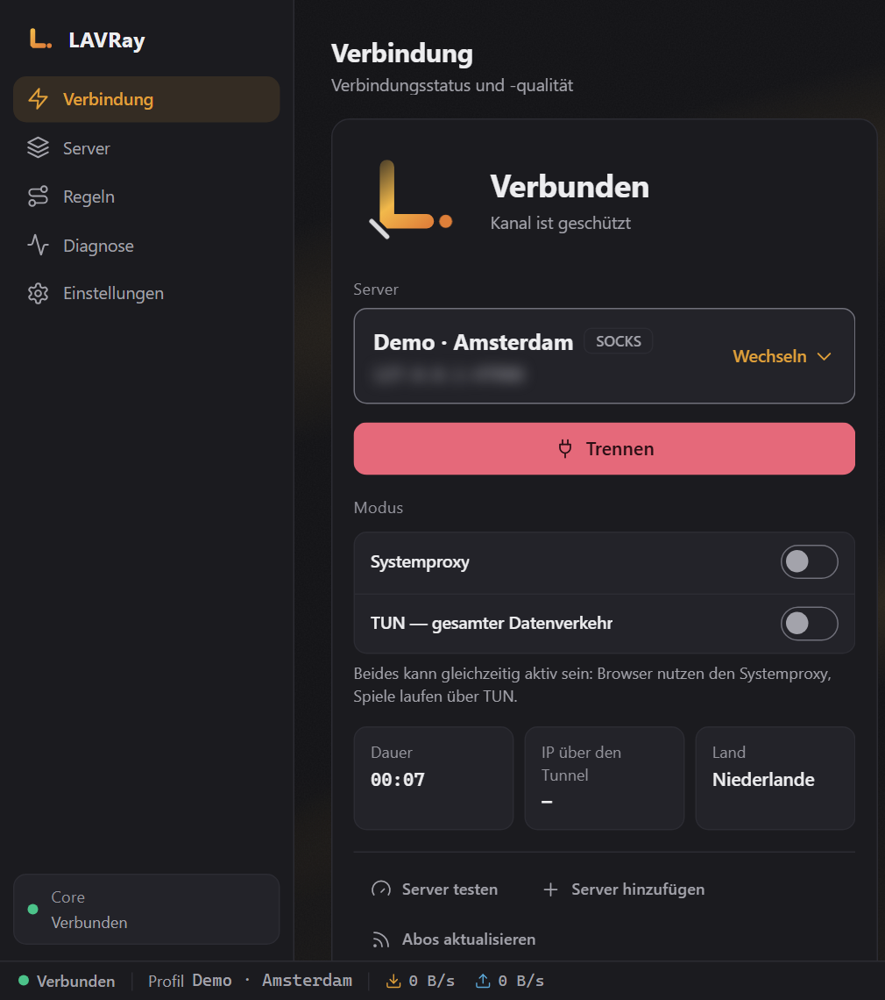
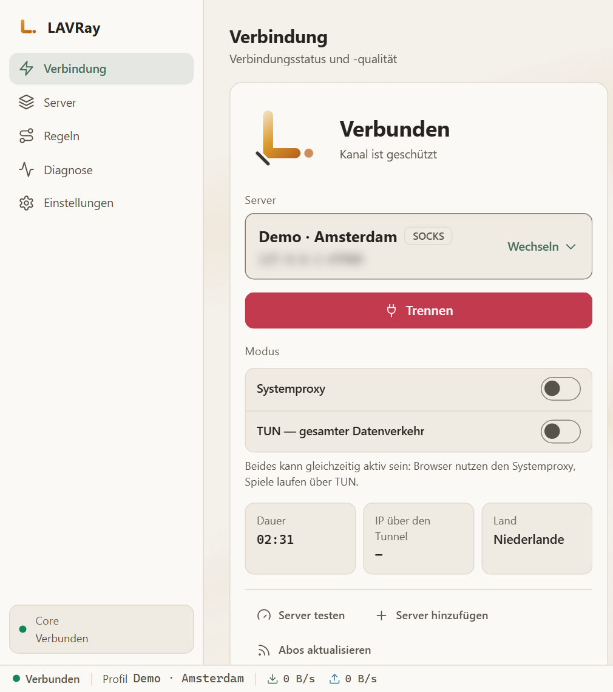
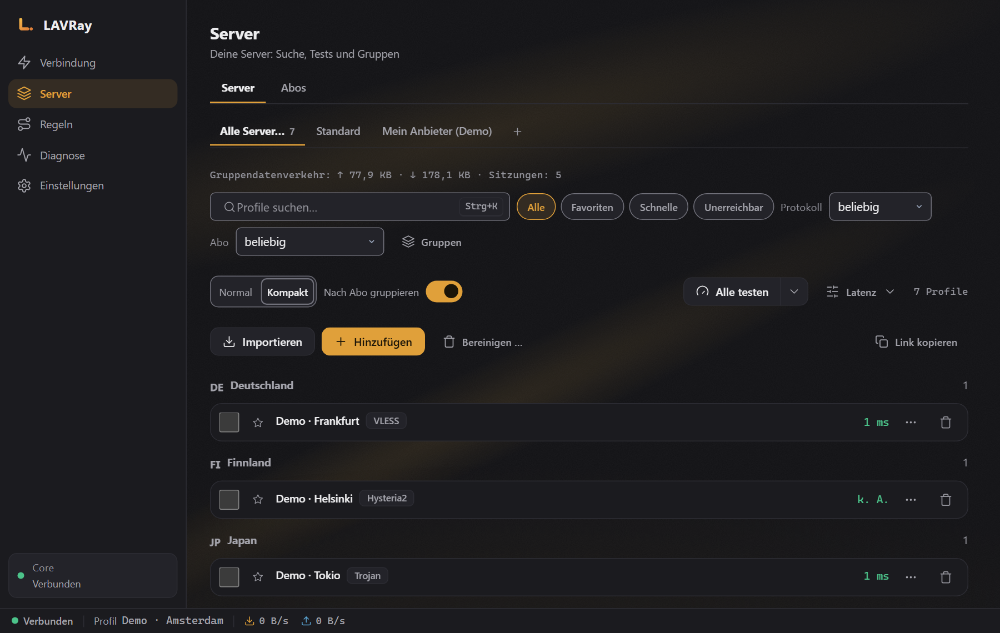
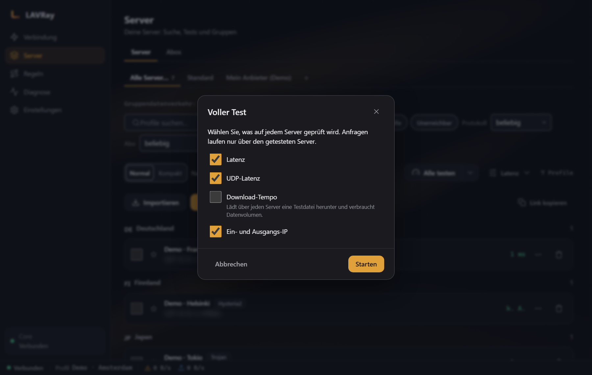
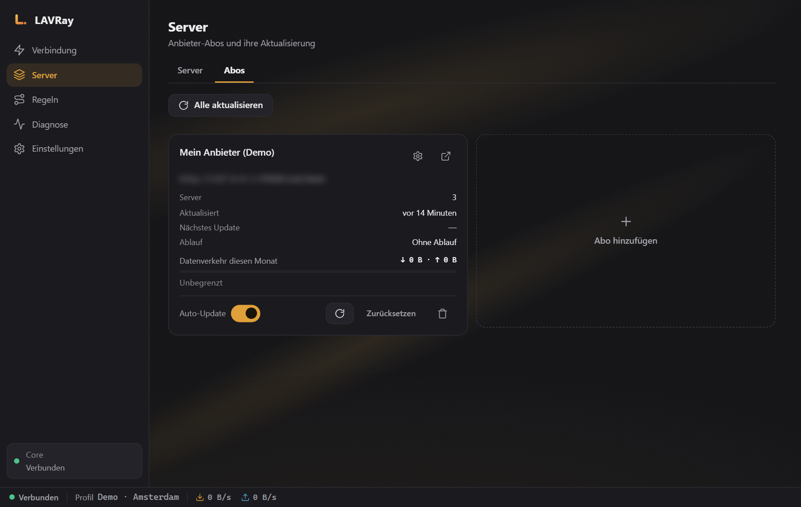
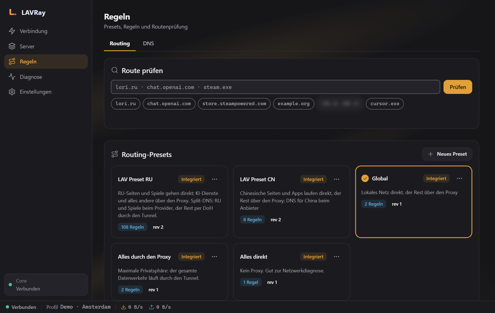
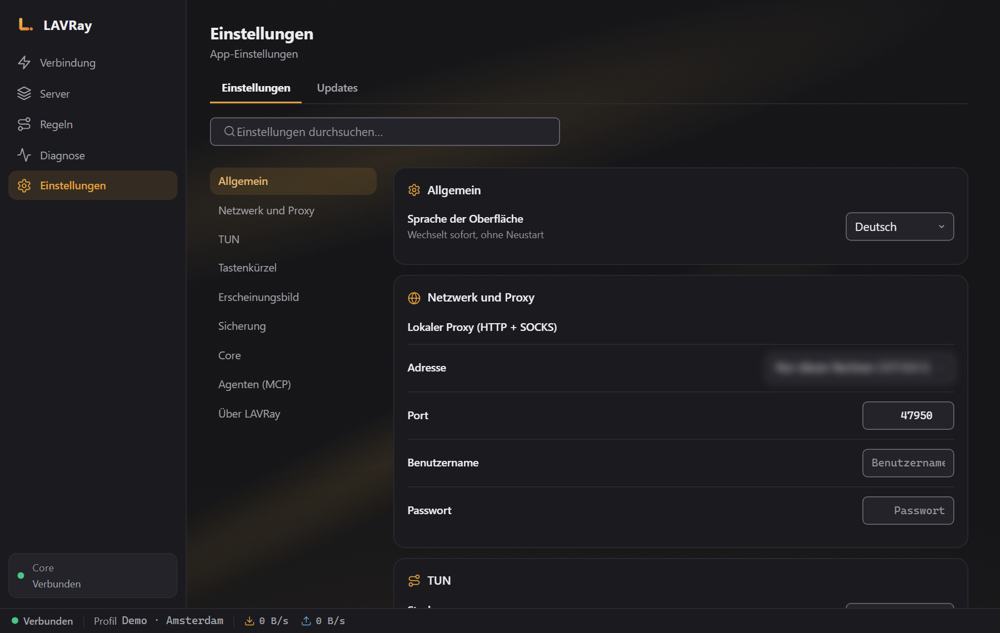
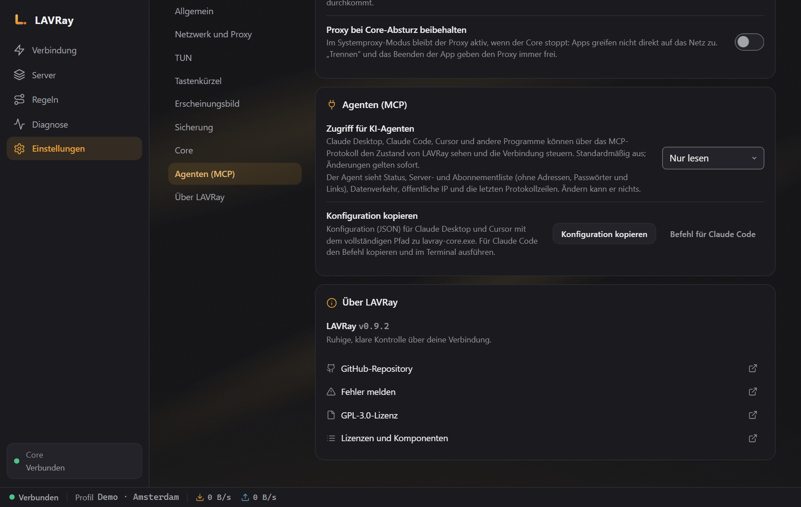

# LAVRay für Windows

[Русский](README.md) · [English](README.en.md) · [中文](README.zh.md) · [Español](README.es.md) · **Deutsch**

*Dies ist eine Übersetzung der russischen README. Die Versionshinweise (Release Notes) sind auf Russisch.*

**LAVRay** — VPN- und Proxy-Client für Windows auf Basis des [sing-box](https://github.com/SagerNet/sing-box)-Cores, Nachfolger von NekoBox. Er verbindet sich mit deinen Servern und Abos und übermittelt dem Anbieter standardmäßig keinerlei Gerätedaten.

<p align="center">
  
  
</p>

- **Protokolle:** VLESS (einschließlich REALITY), VMess, Trojan, Shadowsocks, Hysteria2, TUIC, SOCKS, HTTP.
- **Zwei Modi, auch beide gleichzeitig.** Systemproxy — für Browser und die meisten Programme. TUN — für den gesamten Datenverkehr des Computers, einschließlich Spiele und Konsolenwerkzeuge.
- **Abos** mit automatischer Aktualisierung, Servertests (Latenz, URL-Test, vollständiger Test), fertige Routing-Regelsätze, darunter „LAV Preset RU“ (russische Seiten direkt, der Rest über das VPN).
- **Agenten (MCP):** Claude, Cursor und andere KI-Agenten können den Status abfragen und, wenn du es erlaubst, einen Server verbinden oder wechseln. Siehe [Abschnitt unten](#agenten-mcp).

---

## Herunterladen

Die neueste Version findest du auf der Seite [Releases](../../releases/latest):

| Datei | Was ist das |
|---|---|
| `LAVRay-<Version>-x64-setup.exe` | Installer (empfohlen) |
| `LAVRay-<Version>-portable-x64.zip` | Ohne Installation: entpacken und `LAVRay.exe` starten |
| `SHA256SUMS.txt` | Prüfsummen |

**Der Installer** installiert LAVRay nach `C:\Program Files\LAVRay` und fragt bei der Installation einmal nach Administratorrechten.

**Die Builds sind noch nicht signiert.** Beim ersten Start zeigt Windows SmartScreen möglicherweise „Der Computer wurde durch Windows geschützt“ an — klicke auf „Weitere Informationen“ → „Trotzdem ausführen“. Die Echtheit der Datei kannst du anhand der Prüfsumme überprüfen:

```powershell
Get-FileHash .\LAVRay-0.9.2-x64-setup.exe -Algorithm SHA256
```

Das Ergebnis muss mit der Zeile in `SHA256SUMS.txt` desselben Releases übereinstimmen.

**Anforderungen:** Windows 10 oder 11, x64. Microsoft Edge WebView2 wird benötigt — unter Windows 11 und aktualisiertem Windows 10 ist es bereits vorhanden.

---

## Schnellstart

1. **Füge ein Abo hinzu.** „Server“ → Reiter „Abos“ → „Hinzufügen“, füge den Link deines Anbieters ein und klicke dann auf „Aktualisieren“. Du kannst auch einzelne Server-Links (`vless://`, `trojan://`, `ss://` …) über die Schaltfläche „Importieren“ einfügen.
2. **Verbinde dich.** „Verbindung“ → wähle einen Server („Wechseln“) → „Verbinden“. Der Modus „Systemproxy“ ist eingeschaltet — der Browser läuft bereits über das VPN. Direkt nach dem Verbinden prüft LAVRay, ob tatsächlich Datenverkehr über den Server läuft. Falls nicht, erscheint auf dem Bildschirm eine Warnung „Verbunden, aber über den Server kommt nichts durch“ mit dem Grund. Wähle dann einen anderen Server.
3. **Brauchst du den gesamten Datenverkehr (Spiele, Programme ohne Proxy-Unterstützung)?** Aktiviere „TUN — gesamter Datenverkehr“. Für TUN verlangt Windows Administratorrechte: LAVRay bietet an, sich als Administrator neu zu starten (ein UAC-Fenster), und stellt die Verbindung im TUN-Modus nach dem Neustart selbst fertig.
4. **Autostart.** „Einstellungen“ → „Allgemein“ → „Mit dem System starten“. Wenn LAVRay als Administrator läuft, wird der Autostart als Aufgabe der Aufgabenplanung angelegt: Nach der Anmeldung bei Windows startet LAVRay sofort im Tray mit den nötigen Rechten, und TUN wird ohne Abfragen hochgefahren. Ohne Rechte gilt der normale Windows-Autostart. Wenn der Autostart bereits ohne Rechte aktiviert war, genügt es, die installierte Version einmal als Administrator zu starten (Rechtsklick → „Als Administrator ausführen“): LAVRay überführt den Autostart dann selbst in eine Aufgabe der Aufgabenplanung. Die Portable-Version legt keine Aufgabe mit Rechten an.
5. **Automatische Verbindung.** „Einstellungen“ → „Allgemein“ → „Beim Start automatisch verbinden“ (standardmäßig aus). Nach dem Start verbindet sich LAVRay einmal mit dem zuletzt erfolgreich genutzten Server im selben Modus: bis zu drei Versuche, höchstens 30 Sekunden. Gelingt es nicht, ist der Fehler im Fenster sichtbar. „Trennen“ bleibt ein Trennen: LAVRay verbindet sich nicht von selbst neu. Für TUN wird der Autostart mit Rechten benötigt (Punkt 4).

Das Schließen des Fensters minimiert LAVRay in den Tray; das lässt sich unter „Einstellungen“ → „Beim Schließen in den Tray minimieren“ ausschalten. Vollständig beendest du LAVRay über „Beenden“ im Menü des Tray-Symbols: Der Core wird gestoppt, der Systemproxy wird entfernt.

**Wechselst du von NekoBox?** Beim ersten Start (oder in den „Einstellungen“) klicke auf „Aus NekoBox importieren“: LAVRay findet die Daten von NekoBox selbst, zeigt dir, wie viele Gruppen, Server und Routen übernommen werden, und übernimmt sie mit einer einzigen Aktion. Eine erneute Übernahme erzeugt keine Duplikate.

---

## Bedienung

### Server



- Server werden nach Ländern und Abos gruppiert; es gibt eine Suche (`Ctrl+K`), Favoriten sowie die Filter „Schnelle“ / „Unerreichbar“.
- „Alle testen“ misst die Latenz. Im Menü ▾ daneben:
  - **URL-Test** — über jeden Server wird eine echte Seite geöffnet: Man sieht, ob der Server tatsächlich funktioniert und nicht nur, ob sein Port antwortet. Geeignet auch für Hysteria2/TUIC.
  - **Voller Test** — Latenz, UDP, Download-Geschwindigkeit und Austritts-IP; mit Häkchen wählst du aus, was gemessen wird (die Geschwindigkeit lädt eine Datei über jeden Server herunter, daher ist sie standardmäßig aus).



Während der Tests wird die aktuelle Verbindung nicht unterbrochen.

Im Menü einer Serverzeile stehen: „QR-Code anzeigen“ (kann mit dem Telefon gescannt werden), „In Gruppe verschieben…“, „Duplizieren“, „Datenverkehr zurücksetzen“, „Domain in IP auflösen“ und „Konfiguration exportieren …“ — die Datei enthält Geheimnisse, LAVRay warnt davor. „Bereinigen …“ entfernt „Unerreichbar“ (nicht bestandene Prüfung) oder „Duplikate“ — zuerst zeigt es die Liste, gelöscht wird nach Bestätigung; der aktive Server und die Glieder von Ketten bleiben unberührt.

Der Import akzeptiert Links, Dateien und QR-Codes: aus einem Bild, aus der Zwischenablage oder per Bildschirmfoto. XHTTP-Links werden importiert, aber als „vom Core nicht unterstützt“ markiert — über einen solchen Server kannst du dich derzeit nicht verbinden.

**Eigenes JSON für den Server.** Im Server-Editor gibt es die Felder „Custom-Outbound-JSON“ (ergänzt das Outbound dieses Servers) und „Custom-Config-JSON“ (ergänzt die gesamte Konfiguration). Nach dem Speichern zeigt LAVRay, was genau sie in der endgültigen Konfiguration ändern — Passwörter und Schlüssel sind in diesem Fenster ausgeblendet — und wendet sie erst an, wenn du „Ich verstehe, dass dies die Konfiguration ändert“ aktivierst und auf „Anwenden“ klickst. Jede Änderung am JSON hebt die Bestätigung auf: Ein solcher Server ist in der Liste mit dem Hinweis „Custom: nicht bestätigt“ markiert; ein Klick öffnet dasselbe Fenster.

### Verbindungen

Der Bildschirm „Verbindungen“ zeigt jede Verbindung, solange du verbunden bist: Adresse, über welchen Outbound sie läuft (mit Kette), Routing-Regel, wie viel gesendet und empfangen wurde und wie lange sie dauert. Die Chips „Alle / Proxy / Direkt / Blockiert“ und die Suche filtern die Zeilen, „Pause“ friert die Liste ein. Im Zeilenmenü stehen „Adresse kopieren“, „Verbindung schließen“ sowie „Regel erstellen: direkt“ / „Regel erstellen: über den Proxy“. Geschlossene Verbindungen bleiben im Verlauf (bis zu 1000), solange der Bildschirm geöffnet ist; nach dem Trennen wird der Verlauf geleert. Verbindungsadressen werden nicht an Agenten (MCP) übergeben.

Die Geschwindigkeit in der Statusleiste und das Diagramm auf dem Bildschirm „Verbindung“ zeigen den echten Datenverkehr; daneben steht „Sitzungs-Datenverkehr“. Das Volumen wird auch pro Server gesammelt.

### Abos



Abos werden nach Zeitplan und manuell aktualisiert („Alle aktualisieren“ zeigt das Ergebnis). Die Aktualisierung läuft transaktional ab: Liefert der Anbieter einen Fehler oder eine leere Liste, bleiben die alten Server erhalten; eine fehlgeschlagene Aktualisierung kannst du mit „Zurücksetzen“ rückgängig machen.

### Routing-Regeln



Integrierte Presets: „Global“, „Alles durch den Proxy“, „Alles direkt“, **LAV Preset RU** und LAV Preset CN. Unten auf dem Bildschirm kannst du prüfen, wohin eine bestimmte Adresse geht.

Eigene Presets: „Neues Preset“, „Duplizieren“, „Umbenennen“, „Preset exportieren“ / „Preset importieren“ (einschließlich NekoRay-Routen), sechs Regellisten und Prozessregeln. Ein integriertes Preset bleibt unverändert: Eine Bearbeitung erstellt eine Kopie, und „Auf Original zurücksetzen“ setzt die Kopie wieder auf das integrierte Preset zurück.

### Diagnose und Protokoll

Die Leck-Prüfung (IP über den Tunnel und direkt, DNS, IPv6) findest du direkt auf dem Bildschirm „Verbindung“. Unter „Diagnose“ gibt es die Selbstprüfung und die Route einer bestimmten Adresse; auf dem Reiter „Protokoll“ kopiert die Schaltfläche „Protokoll kopieren“ das Protokoll mit bereits ausgeblendeten Passwörtern, UUIDs und Abo-Adressen — du kannst es bedenkenlos einer Fehlermeldung beifügen.

### Einstellungen



Sprache (Русский, English, 中文, Español, Deutsch), Design, Port des lokalen Proxys, Autostart, automatische Verbindung beim Start, „Beim Schließen in den Tray minimieren“, Start minimiert, „Benachrichtigungen“, das globale Kürzel „Verbinden / Trennen“, Abo-Aktualisierung, Verbindungsprüfung nach dem Verbinden, Agenten (MCP).

**„Proxy bei Core-Absturz beibehalten“.** Wenn du das einschaltest, bleibt der Proxy im Modus „Systemproxy“ erhalten, wenn der Core abstürzt — Programme gehen dann nicht direkt ins Internet; der Tray zeigt einen Fehler, und auf dem Bildschirm erscheint die Schaltfläche „Proxy freigeben“. Trennen und Beenden entfernen den Proxy immer.

**„Sicherung“** — „Verschlüsselte Sicherung“ aller Daten (einschließlich der Abo-Links) mit Passwort sowie „Aus Sicherung wiederherstellen…“. Ohne Passwort kann die Sicherung nicht geöffnet werden.

**Neben NekoBox oder einem anderen VPN-Client.** Wenn der Port des lokalen Proxys (standardmäßig 2080) bereits von einem anderen Programm belegt ist, verbindet sich LAVRay nicht und sagt dir klar, dass der Port belegt ist: Ändere den Port unter „Einstellungen → Netzwerk und Proxy“ oder schließe das andere Programm. Die Adresse des TUN-Adapters von LAVRay überschneidet sich nicht mit NekoBox.

---

## Datenschutz: Das Gerät ist im Abo nicht sichtbar

Viele Anbieter begrenzen die Anzahl der Geräte anhand einer Kennung, die der Client sendet (HWID und die Header `x-hwid`, `x-device-os`, `x-device-model`). **LAVRay sendet solche Header standardmäßig nicht**, genau wie NekoBox — in der Abo-Anfrage steht nur der User-Agent `LAVRay/<Version>` ohne Angaben zum Computer.

Verlangt der Anbieter eine HWID, kannst du sie in den Abo-Einstellungen aktivieren („Gerätekennung senden (HWID)“). Dann wird eine zufällige Kennung gesendet, die für diese Installation erzeugt wurde — keine Seriennummern und keine Hardwaredaten.

---

## Agenten (MCP)

LAVRay kann mit KI-Agenten über das [MCP](https://modelcontextprotocol.io)-Protokoll arbeiten: Du kannst Claude oder Cursor bitten: „verbinde dich mit dem schnellsten Server“, „prüfe die Server“, „aktualisiere die Abos“, „welche IP habe ich gerade?“.



**So aktivierst du es**

1. LAVRay → „Einstellungen“ → „Agenten (MCP)“ → wähle den Modus:
   - **Nur lesen** — Verbindungsstatus, Liste der Server und Abos, Datenverkehr, externe IP, Protokoll;
   - **Lesen und steuern** — zusätzlich verbinden, trennen, Server wechseln, Server testen, Abos aktualisieren.
2. Klicke auf „Konfiguration kopieren“ (für Claude Desktop und Cursor) oder auf „Befehl für Claude Code“ — der Pfad zum Programm wird automatisch eingesetzt — und füge ihn ein:
   - **Claude Desktop:** Settings → Developer → Edit Config, Abschnitt `mcpServers`, danach Claude neu starten;
   - **Cursor:** Settings → MCP;
   - **Claude Code:** führe den kopierten Befehl im Terminal aus.

So sieht die Konfiguration für die installierte Version aus:

```json
{
  "mcpServers": {
    "lavray": {
      "command": "C:\\Program Files\\LAVRay\\binaries\\lavray-core.exe",
      "args": ["mcp"]
    }
  }
}
```

```bash
claude mcp add lavray -- "C:\Program Files\LAVRay\binaries\lavray-core.exe" mcp
```

Der Agent funktioniert, solange LAVRay geöffnet ist. Eine Verbindung über den Agenten verhält sich wie die Schaltfläche in der App: Im Modus Systemproxy wird der Windows-Proxy gesetzt und wieder entfernt.

**Sicherheit.** Standardmäßig ist der Zugriff ausgeschaltet. Der Agent erhält einen eigenen Schlüssel mit einer engen Liste erlaubter Aktionen; die Prüfung übernimmt der Core selbst. Der Agent **sieht nicht** Serveradressen, Passwörter, UUIDs, Abo-Links und besuchte Websites (im Protokoll sind sie durch `[addr]` ersetzt). Importieren, Löschen, Ändern von Einstellungen und Regeln kann der Agent in keinem Modus — so kann eine schädliche Webseite, die der Agent liest, dir kein fremdes Abo unterschieben. Details stehen in [`docs/MCP.md`](https://github.com/anatolijlaptev1991-ctrl/lavray/blob/main/docs/MCP.md) im Hauptrepository.

---

## Daten und Deinstallation

| Was | Wo |
|---|---|
| Server, Abos, Einstellungen | `%APPDATA%\LAVRay` |
| Programm | `C:\Program Files\LAVRay` |

Die Deinstallation erfolgt über die Windows-„Einstellungen“ → „Apps“. Du musst LAVRay vorher nicht schließen: Das Deinstallationsprogramm beendet es selbst und entfernt den Systemproxy, und der Programmordner wird vollständig gelöscht (ab 0.9.1). Der Autostart wird zusammen mit dem Programm entfernt. Der Ordner `%APPDATA%\LAVRay` bleibt erhalten, damit du bei einer Neuinstallation deine Server nicht verlierst; lösche ihn manuell, wenn du ihn nicht brauchst.

---

## Was noch nicht funktioniert

- **Die automatische Aktualisierung ist noch nicht eingerichtet.** Der Bildschirm „Updates“ ist vorhanden, aber in diesem Build fehlen die Signaturschlüssel, deshalb zeigt er „Updates sind nicht eingerichtet“ an. Neue Versionen lädst du manuell von der Seite Releases herunter; der Installer wird darüber installiert, Einstellungen und Autostart bleiben erhalten.
- **XHTTP-Transport** — Links werden importiert, aber der Core unterstützt ihn noch nicht.
- **Signierung der Builds mit einem Windows-Zertifikat** (siehe SmartScreen oben).

---

## Fehler melden

[Erstelle ein Issue](../../issues/new/choose): was du getan hast, was du erwartet hast, was stattdessen passiert ist, die Version von LAVRay und das Protokoll („Diagnose“ → „Protokoll“ → „Protokoll kopieren“).

## Quellcode und Lizenz

Der Code (Go-Core, Shell auf Rust/Tauri, Oberfläche auf React) liegt im Hauptrepository [lavray](https://github.com/anatolijlaptev1991-ctrl/lavray); dort findest du auch den Build aus dem Quellcode (`shell/build.ps1`). Dieses Repository ist die Release-Seite für Windows.

Lizenz [GPL-3.0-only](LICENSE). LAVRay basiert auf nekoray/NekoBox (GPL-3.0) und sing-box (GPL-3.0 oder neuer).
