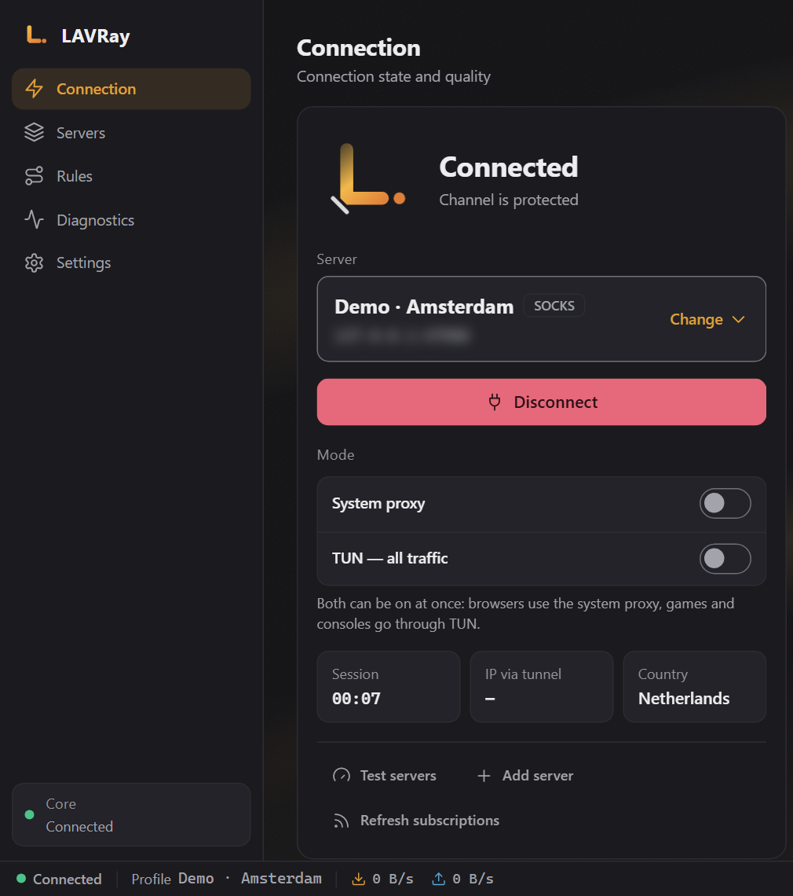
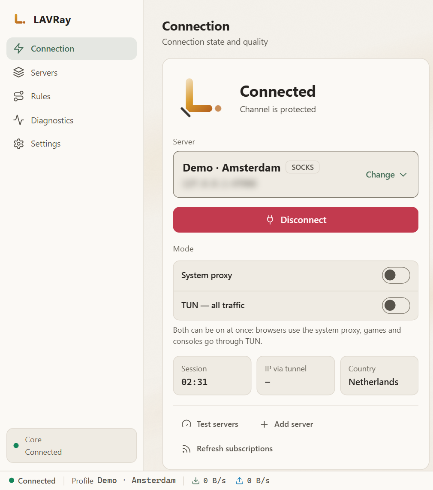
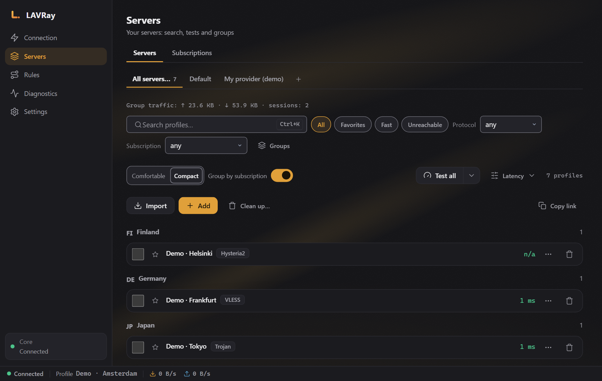
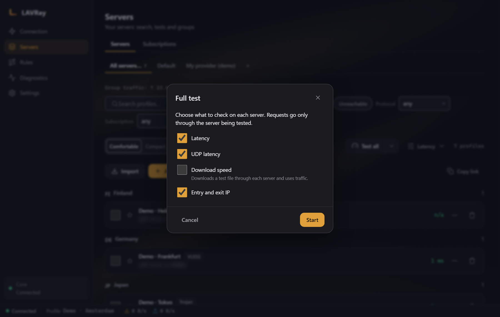
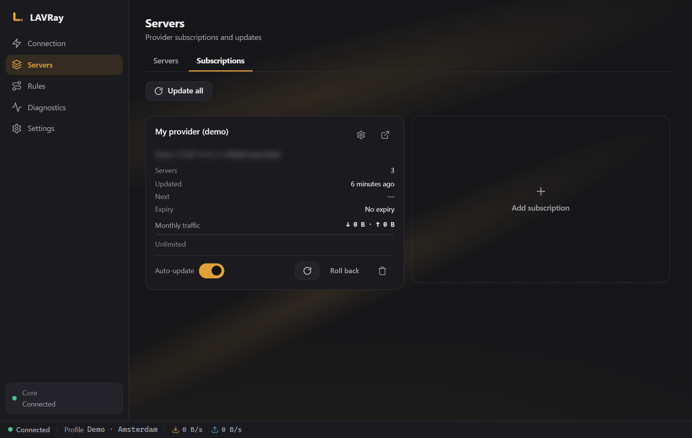
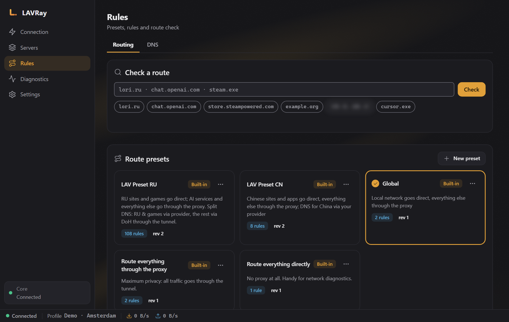
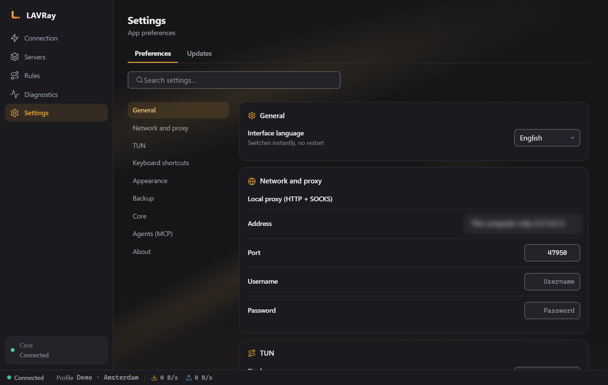
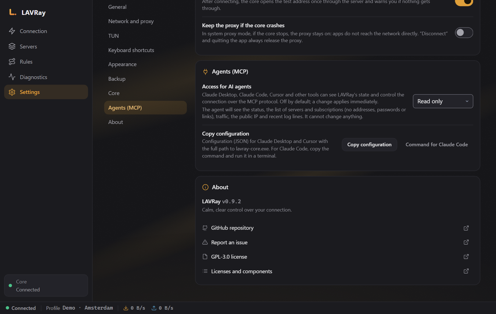

# LAVRay for Windows

[Русский](README.md) · **English** · [中文](README.zh.md) · [Español](README.es.md) · [Deutsch](README.de.md)

*This is a translation of the Russian README. Release notes are in Russian.*

**LAVRay** is a VPN and proxy client for Windows built on the [sing-box](https://github.com/SagerNet/sing-box) core, the successor to NekoBox. It connects to your servers and subscriptions and, by default, does not send the subscription provider any data about your device.

<p align="center">
  
  
</p>

- **Protocols:** VLESS (including REALITY), VMess, Trojan, Shadowsocks, Hysteria2, TUIC, SOCKS, HTTP.
- **Two modes, both can be on at once.** System proxy — for browsers and most programs. TUN — for all of the computer's traffic, including games and command-line tools.
- **Subscriptions** with automatic updates, server checks (latency, URL test, full test), ready-made routing rule sets, including "LAV Preset RU" (Russian sites direct, everything else through the VPN).
- **Agents (MCP):** Claude, Cursor and other AI agents can check the status and, if you allow it, connect or switch the server. See [the section below](#agents-mcp).

---

## Download

The latest version is on the [Releases](../../releases/latest) page:

| File | Description |
|---|---|
| `LAVRay-<version>-x64-setup.exe` | Installer (recommended) |
| `LAVRay-<version>-portable-x64.zip` | No installation: extract and run `LAVRay.exe` |
| `SHA256SUMS.txt` | Checksums |

**The installer** installs LAVRay to `C:\Program Files\LAVRay` and asks for administrator rights once during installation.

**The builds are not signed yet.** On first launch, Windows SmartScreen may show "Windows protected your PC" — click "More info" → "Run anyway". You can verify the file's authenticity by its checksum:

```powershell
Get-FileHash .\LAVRay-0.9.2-x64-setup.exe -Algorithm SHA256
```

The result must match the line in `SHA256SUMS.txt` of the same release.

**Requirements:** Windows 10 or 11, x64. Microsoft Edge WebView2 is required — it is already present on Windows 11 and up-to-date Windows 10.

---

## Quick start

1. **Add a subscription.** "Servers" → the "Subscriptions" tab → "Add", paste your provider's link, then "Refresh". You can also paste individual server links (`vless://`, `trojan://`, `ss://` …) with the "Import" button.
2. **Connect.** "Connection" → choose a server ("Change") → "Connect". The "System proxy" mode is on — your browser already works through the VPN. Right after connecting, LAVRay checks that traffic actually goes through the server; if not, the screen shows a warning "Connected, but nothing gets through the server" with the reason. In that case, choose a different server.
3. **Need all traffic (games, programs without proxy support)?** Turn on "TUN — all traffic". TUN requires administrator rights on Windows: LAVRay will offer to restart as administrator (one UAC prompt), and after the restart it will finish connecting in TUN mode by itself.
4. **Autostart.** "Settings" → "General" → "Launch at system startup". If LAVRay is running as administrator, the autostart is created as a Task Scheduler task: after you sign in to Windows, LAVRay starts in the tray with the required rights, and TUN comes up without prompts. Without administrator rights, the regular Windows autostart is used. If autostart was already enabled without administrator rights, it is enough to launch the installed LAVRay once as administrator (right-click → "Run as administrator"): it will move the autostart to a Task Scheduler task by itself. The portable version does not create a task with administrator rights.
5. **Auto-connect.** "Settings" → "General" → "Connect automatically at startup" (off by default). After launch, LAVRay connects once to the last successfully connected server in the same mode: up to three attempts, no longer than 30 seconds. If that fails, the error is shown in the window. "Disconnect" remains a disconnect: LAVRay does not reconnect on its own. TUN requires autostart with administrator rights (item 4).

Closing the window minimizes LAVRay to the tray; you can turn this off in "Settings" → "Minimize to tray on close". To quit completely, use "Quit" in the tray icon menu: the core stops and the system proxy is removed.

**Switching from NekoBox?** On first launch (or in "Settings"), click "Import from NekoBox": LAVRay will find your NekoBox data itself, show how many groups, servers and routes will be imported, and import them in one step. Importing again does not create duplicates.

---

## How to use

### Servers



- Servers are grouped by country and subscription. There is search (`Ctrl+K`), favorites, and the filters "Fast" / "Unreachable".
- "Test all" measures latency. The ▾ menu next to it has:
  - **URL test** — a real page is opened through each server, so you can see whether the server actually works, not just whether its port responds. It also works for Hysteria2/TUIC.
  - **Full test** — latency, UDP, download speed and exit IP; check boxes select what to measure (the speed test downloads a file through each server, so it is off by default).



The current connection is not interrupted while tests are running.

In the server row menu: "Show QR code" (you can scan it with your phone), "Move to group…", "Duplicate", "Reset traffic", "Resolve domain to IP", and "Export config…" — the file contains secrets, and LAVRay warns you about this. "Clean up…" removes "Unavailable" (servers that failed the check) or "Duplicates" — it first shows the list and removes them only after confirmation; the active server and chain nodes are never touched.

Import accepts links, files and QR codes: from an image, from the clipboard, or from a screenshot. XHTTP links are imported but are marked "not supported by the core" — you cannot connect through such a server yet.

**Custom JSON for a server.** The server editor has the fields "Custom outbound JSON" (merged into this server's outbound) and "Custom config JSON" (merged into the whole config). After saving, LAVRay shows what exactly they change in the final config — passwords and keys are hidden in this window — and applies them only when you tick "I understand this changes the config" and click "Apply". Any edit to the JSON clears the confirmation: such a server is marked in the list with the badge "custom: not confirmed"; clicking it opens the same window.

### Connections

The "Connections" screen shows every connection while you are connected: the address, which outbound it goes through (with the chain), the routing rule, how much was sent and received, and how long it lasts. The chips "All / Proxy / Direct / Block" and the search filter the rows, and "Pause" freezes the list. The row menu has "Copy address", "Close connection", and "Create rule: direct" / "Create rule: via proxy". Closed connections stay in the history (up to 1000) while the screen is open; the history is cleared after disconnecting. Connection addresses are not shared with agents (MCP).

The speed in the status bar and the chart on the "Connection" screen show real traffic; next to them is "Session traffic". Traffic totals are also kept for each server.

### Subscriptions



Subscriptions update on a schedule and manually ("Update all" shows a summary). Updates are transactional: if the provider returns an error or an empty list, the old servers are kept; a failed update can be rolled back with "Roll back".

### Routing rules



Built-in presets: "Global", "Route everything through the proxy", "Route everything directly", **LAV Preset RU** and LAV Preset CN. At the bottom of the screen you can check where a specific address will go.

Custom presets: "New preset", "Duplicate", "Rename", "Export preset" / "Import preset" (including NekoRay routes), six rule lists and process rules. A built-in preset cannot be changed: editing creates a copy, and "Reset to original" returns the copy to the built-in version.

### Diagnostics and log

The leak check (IP through the tunnel and directly, DNS, IPv6) is available right on the "Connection" screen. In "Diagnostics" there are self-checks and the route for a specific address, and on the "Log" tab the "Copy log" button copies the log with passwords, UUIDs and subscription addresses already hidden: you can safely attach it to a bug report.

### Settings



Language (Русский, English, 中文, Español, Deutsch), theme, local proxy port, autostart, auto-connect at startup, "Minimize to tray on close", start minimized, "Notifications", the global shortcut for "Connect / disconnect", subscription updates, connectivity check after connecting, agents (MCP).

**"Keep the proxy if the core crashes".** If enabled, when the core stops unexpectedly in "System proxy" mode, the proxy stays in place — programs do not connect to the internet directly; the tray shows an error, and a "Release proxy" button appears on the screen. Disconnecting and quitting always remove the proxy.

**"Backup"** — "Encrypted backup" of all data (including subscription links), protected by a password, and "Restore from backup…". Without the password, the backup cannot be opened.

**Alongside NekoBox or another VPN client.** If the local proxy port (2080 by default) is already used by another program, LAVRay will not connect and will say directly that the port is in use: change the port in "Settings → Network and proxy" or close the other program. The address of LAVRay's TUN adapter does not overlap with NekoBox's.

---

## Privacy: your device is not visible to the subscription

Many providers limit the number of devices by an identifier sent by the client (HWID and the `x-hwid`, `x-device-os`, `x-device-model` headers). **By default, LAVRay does not send these headers**, just like NekoBox — the subscription request contains only the User-Agent `LAVRay/<version>` with no computer data.

If the provider requires an HWID, it can be enabled in the subscription settings ("Send a device identifier (HWID)"). In that case, a random identifier created for this installation is sent — not serial numbers or hardware data.

---

## Agents (MCP)

LAVRay can work with AI agents over the [MCP](https://modelcontextprotocol.io) protocol: you can ask Claude or Cursor to connect you to the fastest server, check the servers, refresh subscriptions, or tell you your current IP.



**How to enable**

1. LAVRay → "Settings" → "Agents (MCP)" → choose a mode:
   - **Read only** — connection status, the list of servers and subscriptions, traffic, external IP, log;
   - **Read and control** — plus connect, disconnect, change server, test servers, update subscriptions.
2. Click "Copy configuration" (for Claude Desktop and Cursor) or "Command for Claude Code" — the path to the program is filled in automatically — and paste it:
   - **Claude Desktop:** Settings → Developer → Edit Config, the `mcpServers` section, then restart Claude;
   - **Cursor:** Settings → MCP;
   - **Claude Code:** run the copied command in a terminal.

This is what the configuration looks like for the installed version:

```json
{
  "mcpServers": {
    "lavray": {
      "command": "C:\\Program Files\\LAVRay\\binaries\\lavray-core.exe",
      "args": ["mcp"]
    }
  }
}
```

```bash
claude mcp add lavray -- "C:\Program Files\LAVRay\binaries\lavray-core.exe" mcp
```

The agent works while LAVRay is open. Connecting through an agent behaves like the button in the app: in system proxy mode, the Windows proxy is set and removed.

**Security.** Access is disabled by default. The agent gets a separate key with a narrow list of allowed actions, and the core itself performs the check. The agent **cannot see** server addresses, passwords, UUIDs, subscription links or visited websites (in the log they are replaced with `[addr]`). The agent cannot import, delete, or change settings and rules in any mode — so a malicious web page read by the agent cannot slip you someone else's subscription. Details are in [`docs/MCP.md`](https://github.com/anatolijlaptev1991-ctrl/lavray/blob/main/docs/MCP.md) in the main repository.

---

## Data and uninstallation

| What | Where |
|---|---|
| Servers, subscriptions, settings | `%APPDATA%\LAVRay` |
| The program | `C:\Program Files\LAVRay` |

To uninstall, use Windows "Settings" → "Apps". You do not need to close LAVRay beforehand: the uninstaller closes it and removes the system proxy by itself, and the program folder is removed entirely (since 0.9.1). Autostart is removed together with the program. The `%APPDATA%\LAVRay` folder stays so that your servers are not lost on reinstall; delete it manually if you don't need it.

---

## Current limitations

- **Automatic updates are not configured yet.** The "Updates" screen exists, but this build has no signing keys, so it shows "Updates are not configured". New versions are downloaded manually from the Releases page; the installer installs over the existing version, and settings and autostart are kept.
- **XHTTP transport** — links are imported, but the core does not support it yet.
- **Signing builds with a Windows certificate** (see SmartScreen above).

---

## Report a bug

[Create an issue](../../issues/new/choose): what you did, what you expected, what went wrong, the LAVRay version, and the log ("Diagnostics" → "Log" → "Copy log").

## Source code and license

The code (Go core, Rust/Tauri shell, React interface) is in the main [lavray](https://github.com/anatolijlaptev1991-ctrl/lavray) repository, which also has build-from-source instructions (`shell/build.ps1`). This repository is the Windows releases page.

License: [GPL-3.0-only](LICENSE). LAVRay is based on nekoray/NekoBox (GPL-3.0) and sing-box (GPL-3.0 or later).
