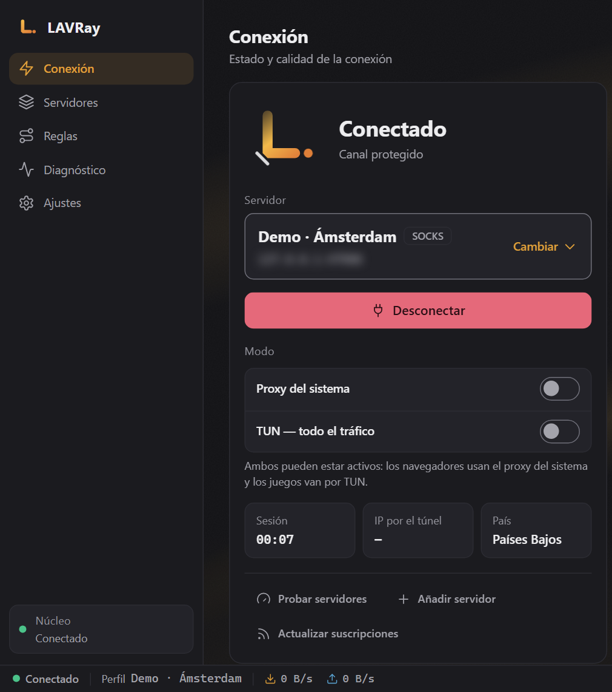
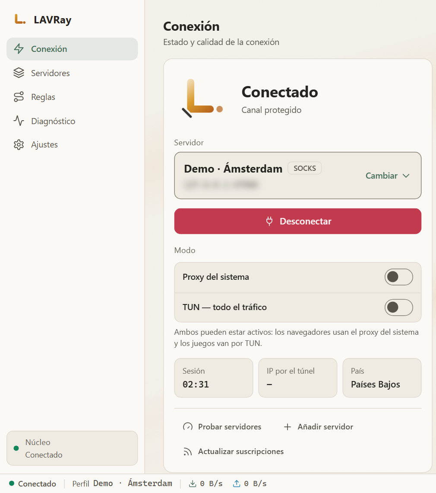
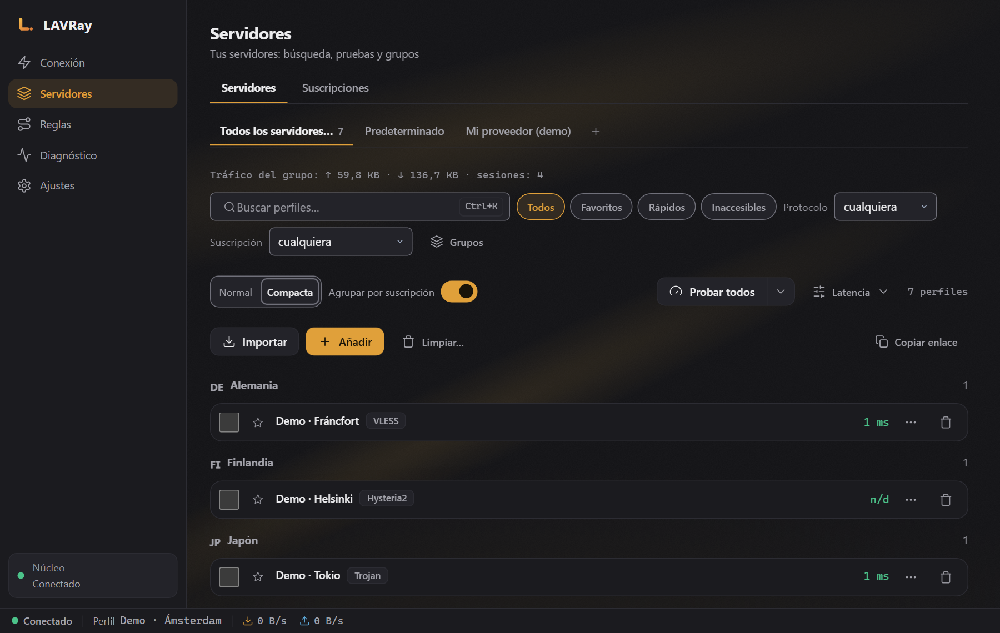
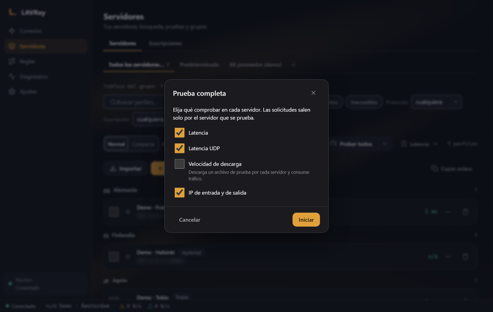
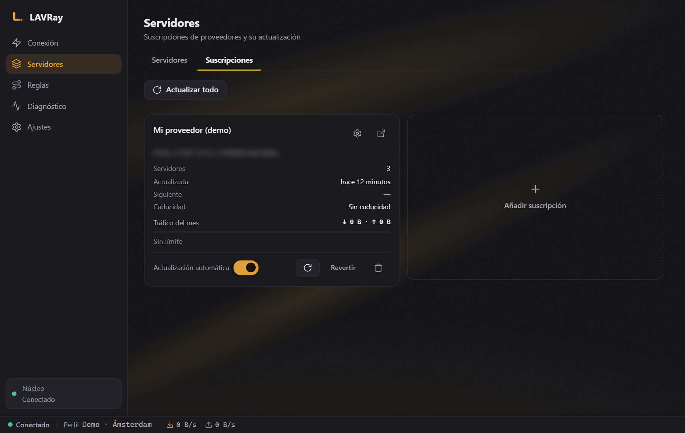
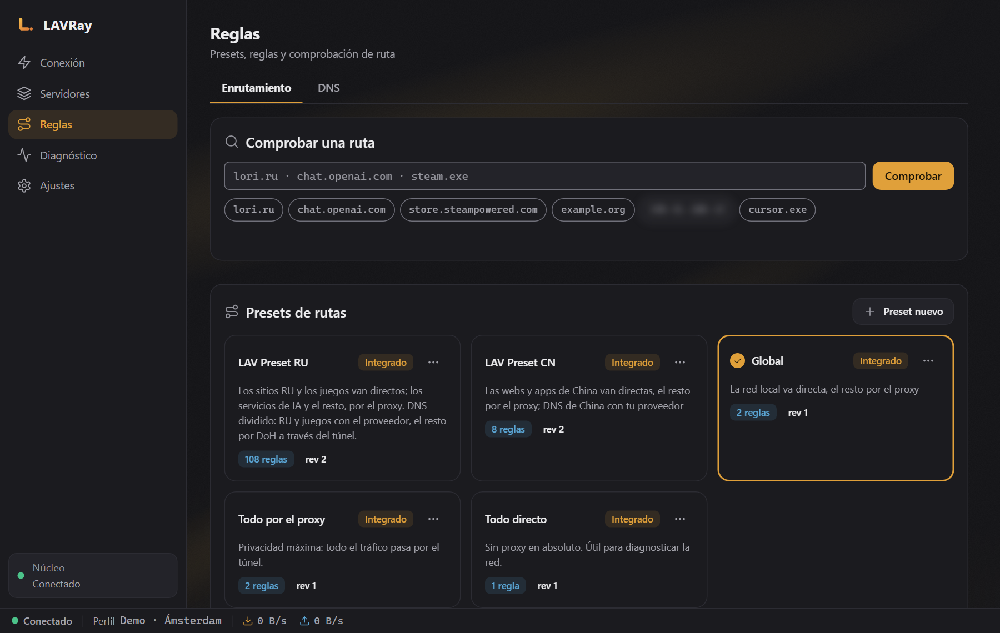
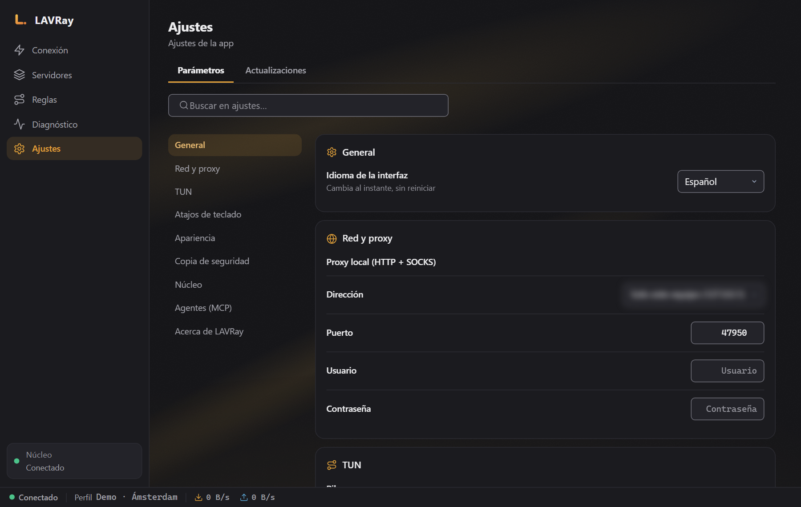
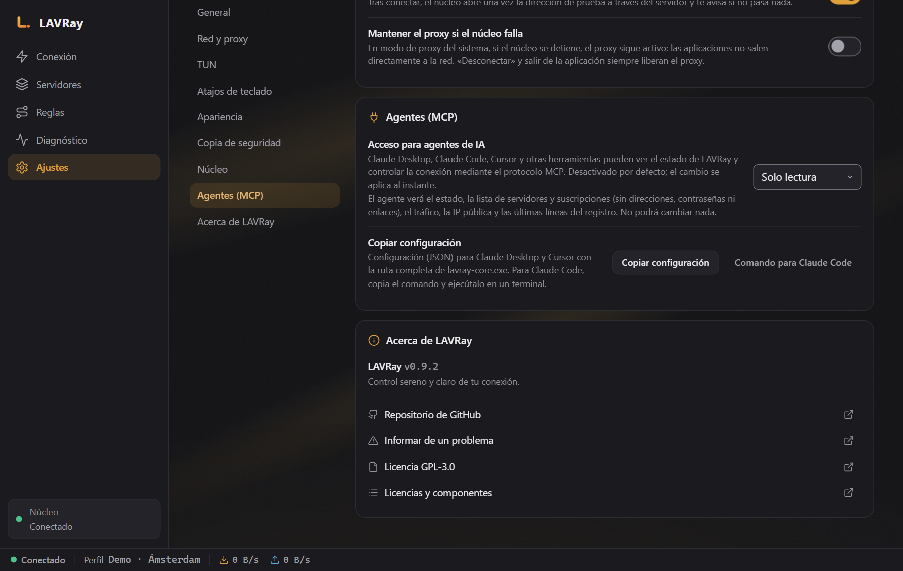

# LAVRay para Windows

[Русский](README.md) · [English](README.en.md) · [中文](README.zh.md) · **Español** · [Deutsch](README.de.md)

*Traducción del README en ruso. Las notas de la versión están en ruso.*

**LAVRay** — cliente VPN y proxy para Windows sobre el núcleo [sing-box](https://github.com/SagerNet/sing-box), sucesor de NekoBox. Se conecta a tus servidores y suscripciones y, por defecto, no envía al proveedor de la suscripción ningún dato sobre el dispositivo.

<p align="center">
  
  
</p>

- **Protocolos:** VLESS (incluido REALITY), VMess, Trojan, Shadowsocks, Hysteria2, TUIC, SOCKS, HTTP.
- **Dos modos, que se pueden usar a la vez.** Proxy del sistema: para navegadores y la mayoría de programas. TUN: para todo el tráfico del equipo, incluidos los juegos y las herramientas de consola.
- **Suscripciones** con actualización automática, comprobación de servidores (latencia, prueba de URL, prueba completa), conjuntos de reglas de enrutamiento listos para usar, incluido «LAV Preset RU» (sitios rusos directos, el resto a través de la VPN).
- **Agentes (MCP):** Claude, Cursor y otros agentes de IA pueden consultar el estado y, si lo permites, conectar o cambiar de servidor. Consulta la [sección siguiente](#agentes-mcp).

---

## Descargar

La última versión está en la página de [Releases](../../releases/latest):

| Archivo | Qué es |
|---|---|
| `LAVRay-<versión>-x64-setup.exe` | Instalador (recomendado) |
| `LAVRay-<versión>-portable-x64.zip` | Sin instalación: descomprimir y ejecutar `LAVRay.exe` |
| `SHA256SUMS.txt` | Sumas de control |

**El instalador** instala LAVRay en `C:\Program Files\LAVRay` y pide una vez los permisos de administrador durante la instalación.

**Las compilaciones todavía no están firmadas.** Al primer inicio, Windows SmartScreen puede mostrar «Windows protegió su PC»: pulsa «Más información» → «Ejecutar de todas formas». La autenticidad del archivo se puede comprobar con la suma de control:

```powershell
Get-FileHash .\LAVRay-0.9.2-x64-setup.exe -Algorithm SHA256
```

El resultado debe coincidir con la línea de `SHA256SUMS.txt` de la misma versión.

**Requisitos:** Windows 10 u 11, x64. Hace falta Microsoft Edge WebView2; en Windows 11 y en Windows 10 actualizado ya está instalado.

---

## Inicio rápido

1. **Añade una suscripción.** «Servidores» → pestaña «Suscripciones» → «Añadir», pega el enlace de tu proveedor y luego pulsa «Actualizar». También puedes pegar enlaces de servidores sueltos (`vless://`, `trojan://`, `ss://` …) con el botón «Importar».
2. **Conéctate.** «Conexión» → elige un servidor («Cambiar») → «Conectar». Está activado el modo «Proxy del sistema», así que el navegador ya funciona a través de la VPN. Justo después de conectar, LAVRay comprueba que el tráfico pasa de verdad por el servidor; si no pasa, aparecerá en pantalla el aviso «Conectado, pero por el servidor no pasa nada» con la causa. En ese caso, elige otro servidor.
3. **¿Necesitas todo el tráfico (juegos, programas sin soporte de proxy)?** Activa «TUN — todo el tráfico». Para TUN, Windows requiere permisos de administrador: LAVRay ofrecerá reiniciarse como administrador (una sola ventana de UAC) y, tras reiniciarse, completará la conexión en TUN por sí mismo.
4. **Arranque automático.** «Ajustes» → «General» → «Arrancar con el sistema». Si LAVRay se ejecuta como administrador, el arranque automático se crea como tarea del Programador de tareas: tras iniciar sesión en Windows, LAVRay se inicia en la bandeja ya con permisos, y TUN se levanta sin pedir confirmación. Sin permisos, se usa el arranque automático normal de Windows. Si el arranque automático ya estaba activado sin permisos, basta con ejecutar una vez el LAVRay instalado como administrador (clic derecho → «Ejecutar como administrador»): él mismo pasará el arranque automático a una tarea del Programador de tareas. La versión portable no crea esa tarea con permisos.
5. **Conexión automática.** «Ajustes» → «General» → «Conectar automáticamente al iniciar» (desactivado por defecto). Tras iniciar, LAVRay se conecta una vez al último servidor al que conectó con éxito, en el mismo modo: hasta tres intentos, no más de 30 segundos. Si no lo consigue, el error se ve en la ventana. «Desconectar» sigue siendo desconectar: LAVRay no se vuelve a conectar por sí mismo. Para TUN hace falta el arranque automático con permisos (punto 4).

Al cerrar la ventana, LAVRay se minimiza a la bandeja; esto se puede desactivar en «Ajustes» → «Minimizar a la bandeja al cerrar». Para salir por completo, usa «Salir» en el menú del icono de la bandeja: el núcleo se detiene y se quita el proxy del sistema.

**¿Vienes de NekoBox?** En el primer inicio (o en «Ajustes») pulsa «Importar de NekoBox»: LAVRay encontrará los datos de NekoBox por sí mismo, mostrará cuántos grupos, servidores y rutas se importarán, y los importará con una sola acción. Repetir la importación no crea duplicados.

---

## Cómo usarlo

### Servidores



- Los servidores se agrupan por país y suscripción; hay búsqueda (`Ctrl+K`), favoritos y los filtros «Rápidos» / «Inaccesibles».
- «Probar todos» mide la latencia. En el menú ▾ junto al botón:
  - **Prueba de URL**: se abre una página real a través de cada servidor, así se ve si el servidor funciona de verdad y no solo si su puerto responde. También sirve para Hysteria2/TUIC.
  - **Prueba completa**: latencia, UDP, velocidad de descarga e IP de salida; con las casillas eliges qué medir (la velocidad descarga un archivo a través de cada servidor, por eso viene desactivada por defecto).



Durante las pruebas, la conexión actual no se interrumpe.

En el menú de la fila del servidor: «Mostrar código QR» (se puede escanear con el teléfono), «Mover a grupo…», «Duplicar», «Restablecer tráfico», «Resolver dominio a IP» y «Exportar configuración…» — el archivo contiene secretos y LAVRay avisa de ello. «Limpiar…» elimina «Inaccesibles» (los que no superaron la prueba) o «Duplicados»: primero muestra la lista y borra solo tras confirmarlo; no toca el servidor activo ni los nodos de las cadenas.

La importación acepta enlaces, archivos y códigos QR: desde una imagen, desde el portapapeles o con una captura de pantalla. Los enlaces XHTTP se importan, pero se marcan como «no compatible con el núcleo»: por ahora no se puede conectar a través de estos servidores.

**JSON propio para el servidor.** En el editor del servidor hay los campos «JSON de outbound personalizado» (complementa el outbound de este servidor) y «JSON de configuración personalizada» (complementa toda la configuración). Tras guardar, LAVRay muestra qué cambian exactamente en la configuración final — las contraseñas y las claves quedan ocultas en esa ventana — y los aplica solo cuando marcas «Entiendo que esto cambia la configuración» y pulsas «Aplicar». Cualquier cambio en el JSON anula la confirmación: ese servidor aparece marcado en la lista con el icono «custom: sin confirmar», y al pulsarlo se abre la misma ventana.

### Conexiones

La pantalla «Conexiones» muestra cada conexión mientras estás conectado: dirección, por qué salida pasa (con la cadena), regla de enrutamiento, cuánto se ha enviado y recibido, y cuánto dura. Los chips «Todas / Proxy / Directo / Bloqueo» y la búsqueda filtran las filas, y «Pausa» congela la lista. En el menú de la fila: «Copiar dirección», «Cerrar conexión» y «Crear regla: directa» / «Crear regla: por el proxy». Las conexiones cerradas se mantienen en el historial (hasta 1000) mientras la pantalla esté abierta; tras desconectar, el historial se borra. Las direcciones de las conexiones no se envían a los agentes (MCP).

La velocidad en la barra de estado y el gráfico de la pantalla «Conexión» muestran el tráfico real; junto a ellos, «Tráfico de sesión». El volumen se acumula también para cada servidor.

### Suscripciones



Las suscripciones se actualizan según un horario y manualmente («Actualizar todo» muestra el resumen). La actualización es transaccional: si el proveedor devuelve un error o una lista vacía, los servidores antiguos se conservan; una actualización fallida se puede «Revertir».

### Reglas de enrutamiento



Conjuntos integrados: «Global», «Todo por el proxy», «Todo directo», **LAV Preset RU** y LAV Preset CN. En la parte inferior de la pantalla puedes comprobar por dónde irá una dirección concreta.

Tus propios conjuntos: «Preset nuevo», «Duplicar», «Renombrar», «Exportar preset» / «Importar preset» (incluidas las rutas de NekoRay), seis listas de reglas y reglas de procesos. Un conjunto integrado no cambia: al editarlo se crea una copia, y «Restablecer al original» devuelve esa copia a la versión integrada.

### Diagnóstico y registro

La comprobación de fugas (IP a través del túnel y directa, DNS, IPv6) está directamente en la pantalla «Conexión». En «Diagnóstico» tienes la autocomprobación y la ruta de una dirección concreta, y en la pestaña «Registro», el botón «Copiar registro» copia el registro con las contraseñas, UUID y direcciones de suscripción ya ocultos: puedes adjuntarlo sin problemas a un mensaje de error.

### Ajustes



Idioma (Русский, English, 中文, Español, Deutsch), tema, puerto del proxy local, arranque automático, conexión automática al iniciar, «Minimizar a la bandeja al cerrar», inicio minimizado, «Notificaciones», atajo global «Conectar / desconectar», actualización de suscripciones, comprobación de la conexión tras conectar, agentes (MCP).

**«Mantener el proxy si el núcleo falla».** Si se activa, ante una parada de emergencia del núcleo en modo «Proxy del sistema» el proxy se mantiene: los programas no salen a Internet directamente; la bandeja muestra el error y en pantalla aparece el botón «Liberar proxy». Desconectar o salir siempre quitan el proxy.

**«Copia de seguridad»** — «Copia de seguridad cifrada» de todos los datos (incluidos los enlaces de suscripción) protegida con contraseña, y «Restaurar desde una copia…». Sin la contraseña no se puede abrir la copia.

**Junto con NekoBox u otro cliente VPN.** Si el puerto del proxy local (2080 por defecto) ya lo usa otro programa, LAVRay no se conectará y lo dirá explícitamente: cambia el puerto en «Ajustes → Red y proxy» o cierra el otro programa. La dirección del adaptador TUN de LAVRay no entra en conflicto con la de NekoBox.

---

## Privacidad: el dispositivo no se ve en la suscripción

Muchos proveedores limitan el número de dispositivos por el identificador que envía el cliente (HWID y las cabeceras `x-hwid`, `x-device-os`, `x-device-model`). **LAVRay, al igual que NekoBox, no envía esas cabeceras por defecto**: en la petición de la suscripción solo va el User-Agent `LAVRay/<versión>`, sin datos sobre el equipo.

Si el proveedor exige HWID, se puede activar en los ajustes de suscripciones («Enviar identificador de dispositivo (HWID)»). En ese caso se envía un identificador aleatorio creado para esta instalación, no números de serie ni datos del hardware.

---

## Agentes (MCP)

LAVRay puede trabajar con agentes de IA mediante el protocolo [MCP](https://modelcontextprotocol.io): puedes pedirle a Claude o Cursor «conéctate al servidor más rápido», «comprueba los servidores», «actualiza las suscripciones», «¿cuál es ahora mi IP?».



**Cómo activarlo**

1. LAVRay → «Ajustes» → «Agentes (MCP)» → elige el modo:
   - **Solo lectura**: estado de la conexión, lista de servidores y suscripciones, tráfico, IP externa, registro;
   - **Lectura y control**: además, conectar, desconectar, cambiar de servidor, comprobar servidores y actualizar suscripciones.
2. Pulsa «Copiar configuración» (para Claude Desktop y Cursor) o «Comando para Claude Code» — la ruta al programa se rellena sola — y pégalo:
   - **Claude Desktop:** Settings → Developer → Edit Config, sección `mcpServers`, y luego reinicia Claude;
   - **Cursor:** Settings → MCP;
   - **Claude Code:** ejecuta el comando copiado en la terminal.

Así se ve la configuración para la versión instalada:

```json
{
  "mcpServers": {
    "lavray": {
      "command": "C:\\Program Files\\LAVRay\\binaries\\lavray-core.exe",
      "args": ["mcp"]
    }
  }
}
```

```bash
claude mcp add lavray -- "C:\Program Files\LAVRay\binaries\lavray-core.exe" mcp
```

El agente funciona mientras LAVRay esté abierto. La conexión a través del agente se comporta como el botón de la aplicación: en modo proxy del sistema, el proxy de Windows se activa y se quita.

**Seguridad.** De forma predeterminada el acceso está desactivado. El agente recibe una clave propia con una lista estrecha de acciones permitidas, y la verificación la hace el propio núcleo. El agente **no ve** las direcciones de los servidores, contraseñas, UUID, enlaces de suscripción ni los sitios visitados (en el registro se sustituyen por `[addr]`). El agente no puede importar, eliminar, cambiar ajustes ni reglas en ningún modo: así, una página web dañina que lea el agente no te podrá colar una suscripción ajena. Detalles en [`docs/MCP.md`](https://github.com/anatolijlaptev1991-ctrl/lavray/blob/main/docs/MCP.md) del repositorio principal.

---

## Datos y desinstalación

| Qué | Dónde |
|---|---|
| Servidores, suscripciones, ajustes | `%APPDATA%\LAVRay` |
| Programa | `C:\Program Files\LAVRay` |

La desinstalación se hace desde la «Configuración» de Windows → «Aplicaciones». No hace falta cerrar LAVRay antes: el desinstalador lo cierra por sí mismo y quita el proxy del sistema, y la carpeta del programa se elimina por completo (desde la 0.9.1). El arranque automático se quita junto con el programa. La carpeta `%APPDATA%\LAVRay` se conserva para no perder los servidores al reinstalar; bórrala manualmente si no la necesitas.

---

## Qué todavía no hace

- **La actualización automática todavía no está configurada.** La pantalla «Actualizaciones» existe, pero en esta compilación no hay claves de firma, por eso muestra «Las actualizaciones no están configuradas». Las nuevas versiones se descargan manualmente desde la página de Releases; el instalador se instala encima y los ajustes y el arranque automático se conservan.
- **Transporte XHTTP**: los enlaces se importan, pero el núcleo todavía no lo admite.
- **Firma de las compilaciones con certificado de Windows** (ver SmartScreen más arriba).

---

## Informar de un error

[Crea un issue](../../issues/new/choose): qué hacías, qué esperabas, qué pasó, la versión de LAVRay y el registro («Diagnóstico» → «Registro» → «Copiar registro»).

## Código fuente y licencia

El código (núcleo en Go, shell en Rust/Tauri, interfaz en React) está en el repositorio principal [lavray](https://github.com/anatolijlaptev1991-ctrl/lavray), donde también está la compilación desde el código fuente (`shell/build.ps1`). Este repositorio es la página de versiones para Windows.

Licencia [GPL-3.0-only](LICENSE). LAVRay se basa en nekoray/NekoBox (GPL-3.0) y sing-box (GPL-3.0 o posterior).
