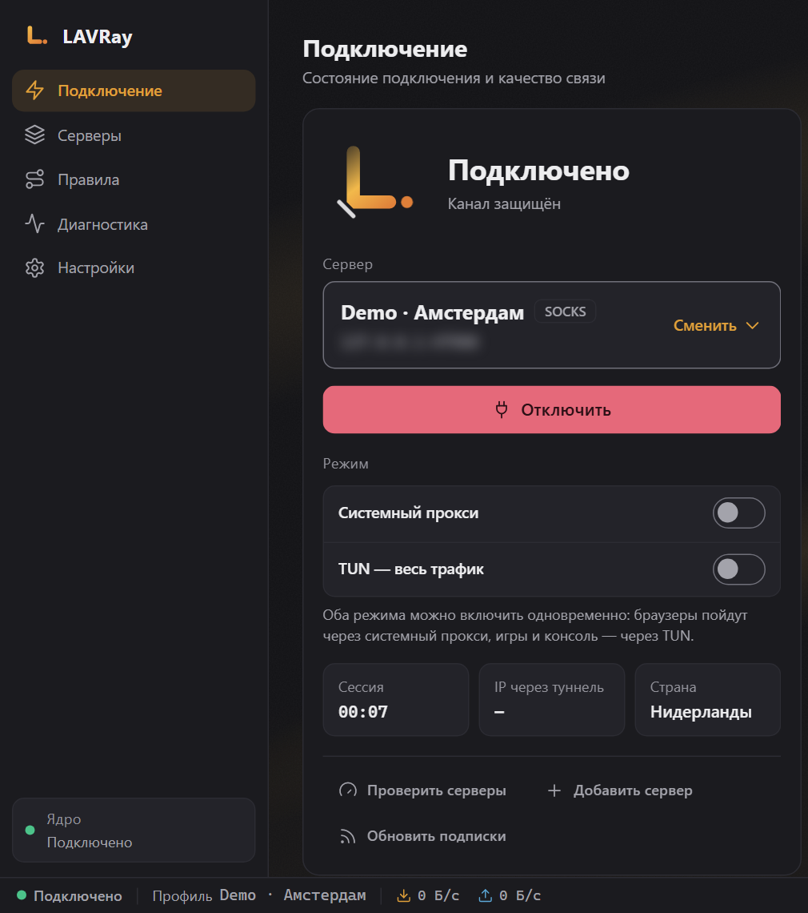
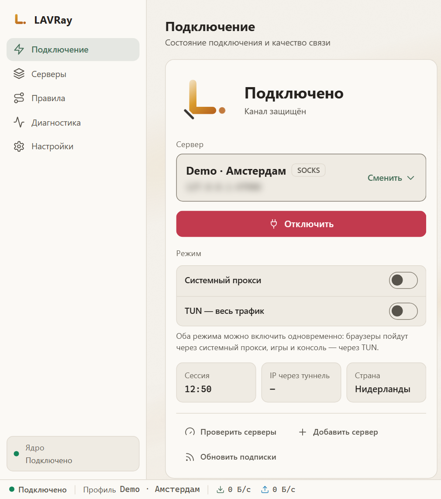
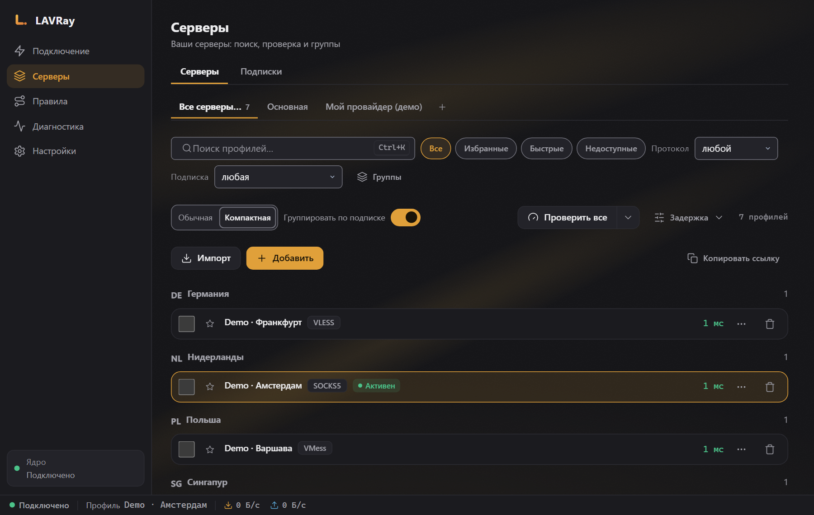
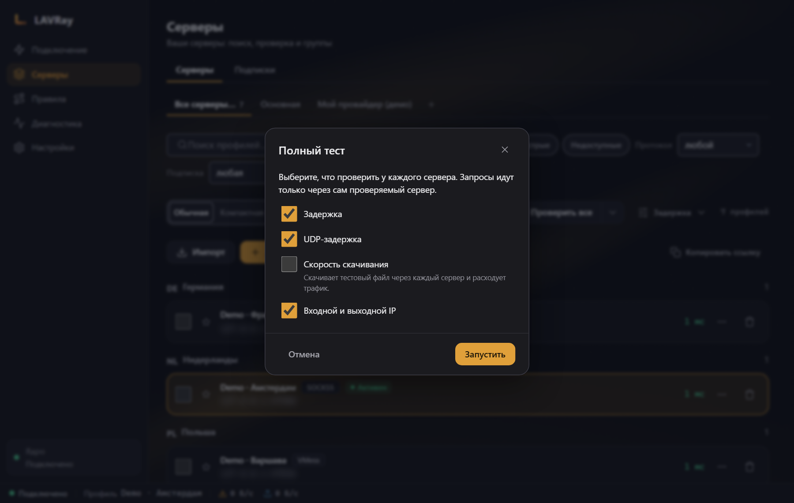
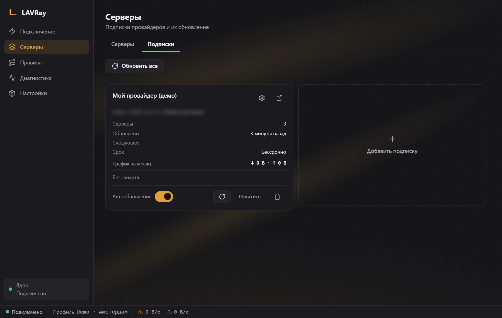
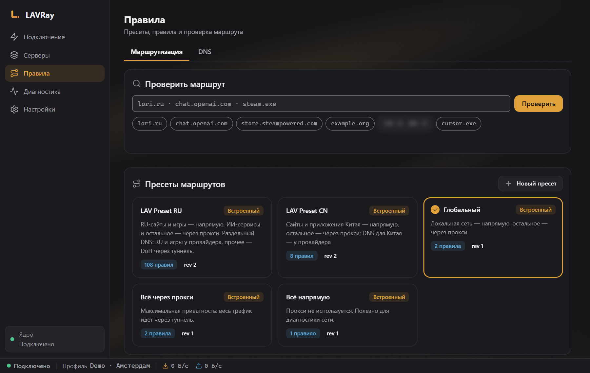
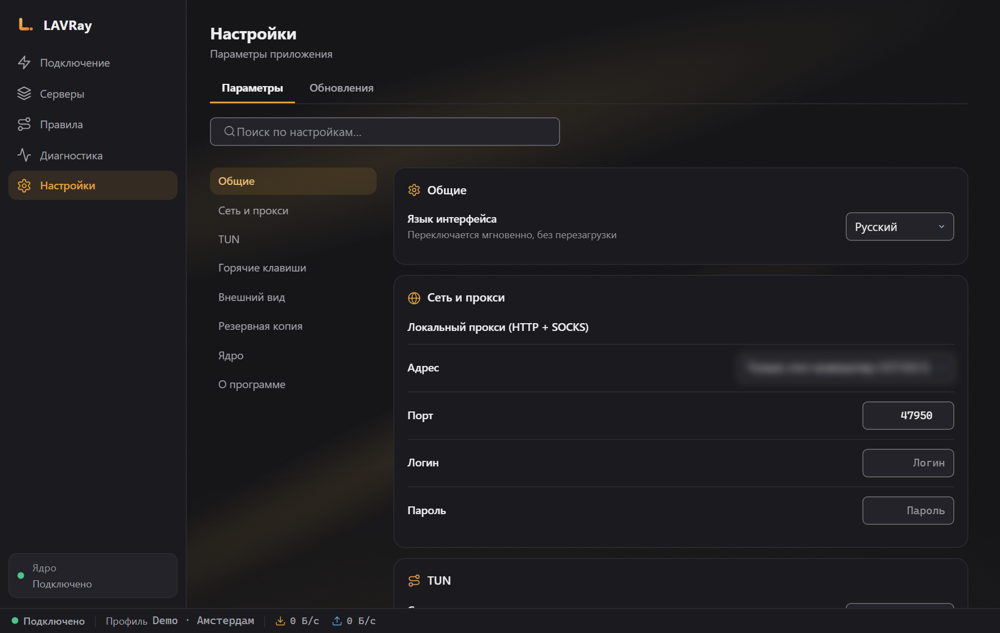
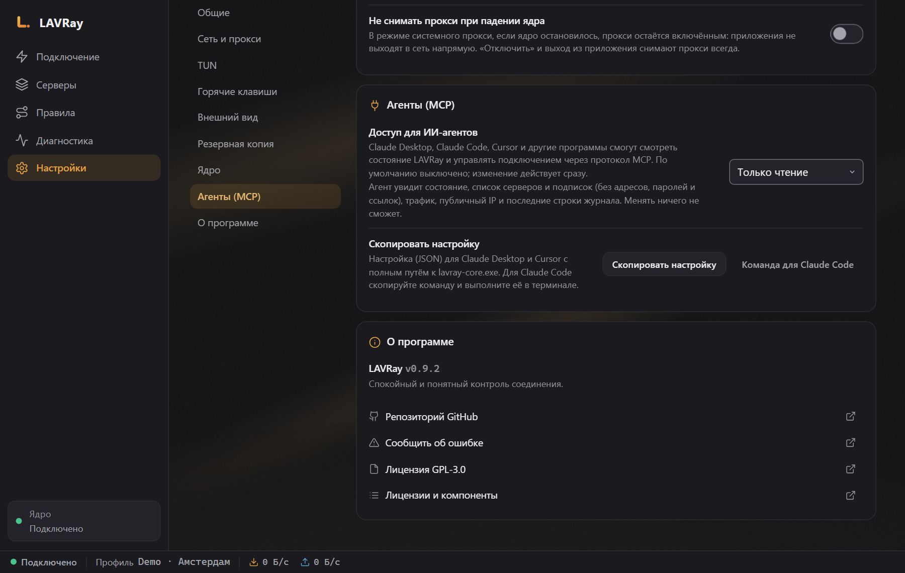

# LAVRay для Windows

**LAVRay** — VPN- и прокси-клиент для Windows на ядре [sing-box](https://github.com/SagerNet/sing-box), наследник NekoBox. Он подключается к вашим серверам и подпискам и по умолчанию не передаёт провайдеру подписки никаких данных об устройстве.

<p align="center">
  
  
</p>

- **Протоколы:** VLESS (в том числе REALITY), VMess, Trojan, Shadowsocks, Hysteria2, TUIC, SOCKS, HTTP.
- **Два режима, можно оба сразу.** Системный прокси — для браузеров и большинства программ. TUN — для всего трафика компьютера, включая игры и консоль.
- **Подписки** с автоматическим обновлением, проверка серверов (задержка, URL-тест, полный тест), готовые наборы правил маршрутизации, в том числе «LAV Preset RU» (российские сайты напрямую, остальное через VPN).
- **Агенты (MCP):** Claude, Cursor и другие ИИ-агенты могут узнать состояние и, если вы разрешите, подключить или переключить сервер. См. [раздел ниже](#агенты-mcp).

---

## Скачать

Последняя версия — на странице [Releases](../../releases/latest):

| Файл | Что это |
|---|---|
| `LAVRay-<версия>-x64-setup.exe` | Установщик (рекомендуется) |
| `LAVRay-<версия>-portable-x64.zip` | Без установки: распаковать и запустить `LAVRay.exe` |
| `SHA256SUMS.txt` | Контрольные суммы |

**Установщик** ставит LAVRay в `C:\Program Files\LAVRay` и при установке один раз просит права администратора.

**Сборки пока не подписаны.** При первом запуске Windows SmartScreen может показать «Система Windows защитила ваш компьютер» — нажмите «Подробнее» → «Выполнить в любом случае». Подлинность файла можно проверить по сумме:

```powershell
Get-FileHash .\LAVRay-0.9.0-x64-setup.exe -Algorithm SHA256
```

Результат должен совпасть со строкой в `SHA256SUMS.txt` того же релиза.

**Требования:** Windows 10 или 11, x64. Нужен Microsoft Edge WebView2 — в Windows 11 и обновлённой Windows 10 он уже есть.

---

## Быстрый старт

1. **Добавьте подписку.** «Серверы» → вкладка «Подписки» → «Добавить», вставьте ссылку от провайдера, затем «Обновить». Можно вставить и отдельные ссылки серверов (`vless://`, `trojan://`, `ss://` …) кнопкой «Импорт».
2. **Подключитесь.** «Подключение» → выберите сервер («Сменить») → «Подключить». Включён режим «Системный прокси» — браузер уже работает через VPN. Сразу после подключения LAVRay проверяет, что через сервер действительно идёт трафик; если нет — на экране появится предупреждение «Подключено, но через сервер ничего не проходит» с причиной. Тогда выберите другой сервер.
3. **Нужен весь трафик (игры, программы без поддержки прокси)?** Включите «TUN — весь трафик». Для TUN Windows требует права администратора: LAVRay предложит перезапуститься от администратора (одно окно UAC) и откроется уже с выбранным TUN — нажмите «Подключить».
4. **Автозапуск.** «Настройки» → «Автозапуск». Если LAVRay запущен от администратора, автозапуск создаётся задачей планировщика: после входа в Windows LAVRay стартует в трее сразу с правами, и TUN поднимается без запросов. Без прав — обычный автозапуск Windows.

Закрытие окна сворачивает LAVRay в трей; это можно выключить в «Настройки» → «Сворачивать в трей при закрытии». Полный выход — «Выход» в меню значка в трее: ядро останавливается, системный прокси снимается.

**Переходите с NekoBox?** На первом запуске (или в «Настройках») нажмите «Перенести из NekoBox»: LAVRay сам найдёт данные NekoBox, покажет, сколько групп, серверов и маршрутов будет перенесено, и перенесёт их одним действием. Повторный перенос не создаёт дублей.

---

## Как пользоваться

### Серверы



- Серверы группируются по странам и подпискам, есть поиск (`Ctrl+K`), избранное и фильтры «Быстрые» / «Недоступные».
- «Проверить все» меряет задержку. В меню ▾ рядом:
  - **URL-тест** — через каждый сервер открывается настоящая страница: видно, работает ли сервер на деле, а не только отвечает ли его порт. Подходит и для Hysteria2/TUIC.
  - **Полный тест** — задержка, UDP, скорость скачивания и IP выхода; галочками выбирается, что мерить (скорость скачивает файл через каждый сервер, поэтому по умолчанию выключена).



Во время тестов текущее подключение не прерывается.

В меню строки сервера: «Показать QR-код» (его можно отсканировать телефоном), «Переместить в группу…», «Дублировать», «Сбросить трафик», «Заменить домен на IP» и «Экспорт конфига…» — файл содержит секреты, LAVRay предупреждает об этом. «Очистка…» удаляет «Недоступные» (не прошедшие проверку) или «Дубликаты» — сначала показывает список, удаляет после подтверждения; активный сервер и звенья цепочек не трогает.

Импорт принимает ссылки, файлы и QR-коды: из картинки, из буфера обмена или снимком экрана. Ссылки XHTTP импортируются, но помечены «не поддерживается ядром» — подключиться через такой сервер пока нельзя.

**Свой JSON для сервера.** В редакторе сервера есть поля «Custom outbound JSON» (дополняет исходящий этого сервера) и «Custom config JSON» (дополняет весь конфиг). После сохранения LAVRay показывает, что именно они меняют в итоговом конфиге — пароли и ключи в этом окне скрыты, — и применяет их, только когда вы отметите «Я понимаю, что это изменяет конфиг» и нажмёте «Применить». Любая правка JSON снимает подтверждение: такой сервер помечен в списке значком «custom: не подтверждено», по нажатию открывается то же окно.

### Соединения

Экран «Соединения» показывает каждое соединение, пока вы подключены: адрес, через какой исходящий оно идёт (с цепочкой), правило маршрутизации, сколько отправлено и получено, сколько длится. Чипы «Все / Прокси / Напрямую / Блок» и поиск отбирают строки, «Пауза» замораживает список. В меню строки — «Копировать адрес», «Закрыть соединение» и «Создать правило: напрямую» / «Создать правило: через прокси». Закрытые соединения остаются в истории (до 1000), пока открыт экран; после отключения история очищается. Адреса соединений агентам (MCP) не передаются.

Скорость в строке состояния и график на экране «Подключение» показывают настоящий трафик, рядом — «Трафик за сессию». Объём копится и по каждому серверу.

### Подписки



Подписки обновляются по расписанию и вручную («Обновить все» показывает итог). Обновление проходит транзакционно: если провайдер вернул ошибку или пустой список, старые серверы остаются; неудачное обновление можно «Откатить».

### Правила маршрутизации



Встроенные наборы: «Глобальный», «Всё через прокси», «Всё напрямую», **LAV Preset RU** и LAV Preset CN. Внизу экрана можно проверить, куда пойдёт конкретный адрес.

Свои наборы: «Новый пресет», «Дублировать», «Переименовать», «Экспорт пресета» / «Импорт пресета» (в том числе маршруты NekoRay), шесть списков правил и правила процессов. Встроенный набор не меняется: правка создаёт копию, а «Сбросить к исходному» возвращает её к встроенному.

### Диагностика и журнал

Проверка утечек (IP через туннель и напрямую, DNS, IPv6) есть прямо на экране «Подключение». В «Диагностике» — самопроверка и маршрут конкретного адреса, а на вкладке «Журнал» кнопка «Копировать журнал» копирует его с уже скрытыми паролями, UUID и адресами подписок: его можно смело прикладывать к сообщению об ошибке.

### Настройки



Язык (русский, English, 中文, Español, Deutsch), тема, порт локального прокси, автозапуск, «Сворачивать в трей при закрытии», запуск свёрнутым, «Уведомления», глобальное сочетание «подключить / отключить», обновление подписок, проверка связи после подключения, агенты (MCP).

**«Не снимать прокси при падении ядра».** Если включить, при аварийной остановке ядра в режиме «Системный прокси» прокси остаётся — программы не уходят в интернет напрямую; трей показывает ошибку, а на экране появляется кнопка «Снять прокси». Отключение и выход снимают прокси всегда.

**«Резервная копия»** — «Зашифрованная резервная копия» всех данных (включая ссылки подписок) под паролем и «Восстановить из копии…». Без пароля копию не открыть.

**Рядом с NekoBox или другим VPN-клиентом.** Если порт локального прокси (по умолчанию 2080) уже занят другой программой, LAVRay не подключится и прямо скажет, что порт занят: смените порт в «Настройки → Сеть и прокси» или закройте другую программу. Адрес TUN-адаптера LAVRay не пересекается с NekoBox.

---

## Приватность: устройство не видно в подписке

Многие провайдеры ограничивают число устройств по идентификатору, который присылает клиент (HWID и заголовки `x-hwid`, `x-device-os`, `x-device-model`). **LAVRay по умолчанию таких заголовков не отправляет**, как и NekoBox, — в запросе подписки только User-Agent `LAVRay/<версия>` без данных о компьютере.

Если провайдер требует HWID, его можно включить в настройках подписок («Передавать идентификатор устройства»). Тогда отправляется случайный идентификатор, созданный для этой установки, — не серийные номера и не данные железа.

---

## Агенты (MCP)

LAVRay умеет работать с ИИ-агентами по протоколу [MCP](https://modelcontextprotocol.io): можно попросить Claude или Cursor «подключись к самому быстрому серверу», «проверь серверы», «обнови подписки», «какой у меня сейчас IP».



**Как включить**

1. LAVRay → «Настройки» → «Агенты (MCP)» → выберите режим:
   - **Только чтение** — состояние подключения, список серверов и подписок, трафик, внешний IP, журнал;
   - **Чтение и управление** — плюс подключить, отключить, сменить сервер, проверить серверы, обновить подписки.
2. Нажмите «Скопировать настройку» (для Claude Desktop и Cursor) или «Команда для Claude Code» — путь к программе подставится сам — и вставьте:
   - **Claude Desktop:** Settings → Developer → Edit Config, раздел `mcpServers`, затем перезапустите Claude;
   - **Cursor:** Settings → MCP;
   - **Claude Code:** выполните скопированную команду в терминале.

Так выглядит настройка для установленной версии:

```json
{
  "mcpServers": {
    "lavray": {
      "command": "C:\\Program Files\\LAVRay\\binaries\\lavray-core.exe",
      "args": ["mcp"]
    }
  }
}
```

```bash
claude mcp add lavray -- "C:\Program Files\LAVRay\binaries\lavray-core.exe" mcp
```

Агент работает, пока открыт LAVRay. Подключение через агента ведёт себя как кнопка в приложении: в режиме системного прокси прокси Windows ставится и снимается.

**Безопасность.** По умолчанию доступ выключен. Агент получает отдельный ключ с узким списком разрешённых действий, проверку делает само ядро. Агент **не видит** адресов серверов, паролей, UUID, ссылок подписок и посещённых сайтов (в журнале они заменены на `[addr]`). Импортировать, удалять, менять настройки и правила агент не может ни в одном режиме — так вредная веб-страница, прочитанная агентом, не подсунет вам чужую подписку. Подробности — в [`docs/MCP.md`](https://github.com/anatolijlaptev1991-ctrl/lavray/blob/main/docs/MCP.md) основного репозитория.

---

## Данные и удаление

| Что | Где |
|---|---|
| Серверы, подписки, настройки | `%APPDATA%\LAVRay` |
| Программа | `C:\Program Files\LAVRay` |

Удаление — через «Параметры» → «Приложения». Автозапуск снимается вместе с программой. Папка `%APPDATA%\LAVRay` остаётся, чтобы при переустановке не потерять серверы; удалите её вручную, если она не нужна.

---

## Что пока не умеет

- **Автообновление пока не настроено.** Экран «Обновления» есть, но в этой сборке нет ключей подписи, поэтому он показывает «Обновления не настроены». Новые версии скачиваются вручную со страницы Releases; установщик ставится поверх, настройки и автозапуск сохраняются.
- **Транспорт XHTTP** — ссылки импортируются, но ядро его пока не поддерживает.
- **Подпись сборок сертификатом Windows** (см. SmartScreen выше).

---

## Сообщить об ошибке

[Создайте issue](../../issues/new/choose): что делали, что ожидали, что получилось, версия LAVRay и журнал («Диагностика» → «Журнал» → «Копировать журнал»).

## Исходный код и лицензия

Код (Go-ядро, оболочка на Rust/Tauri, интерфейс на React) — в основном репозитории [lavray](https://github.com/anatolijlaptev1991-ctrl/lavray), там же сборка из исходников (`shell/build.ps1`). Этот репозиторий — страница выпусков для Windows.

Лицензия [GPL-3.0-only](LICENSE). LAVRay основан на nekoray/NekoBox (GPL-3.0) и sing-box (GPL-3.0 или новее).
