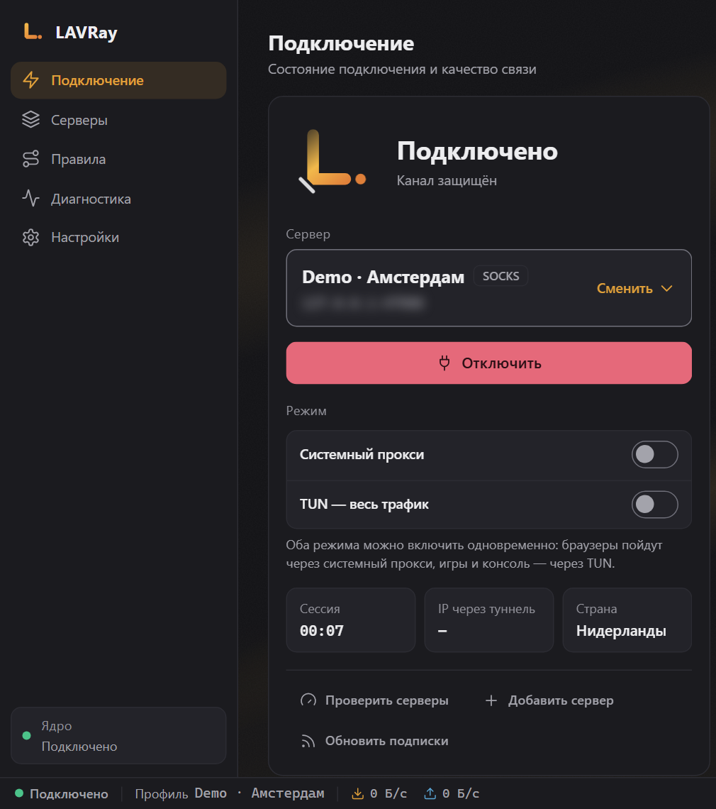
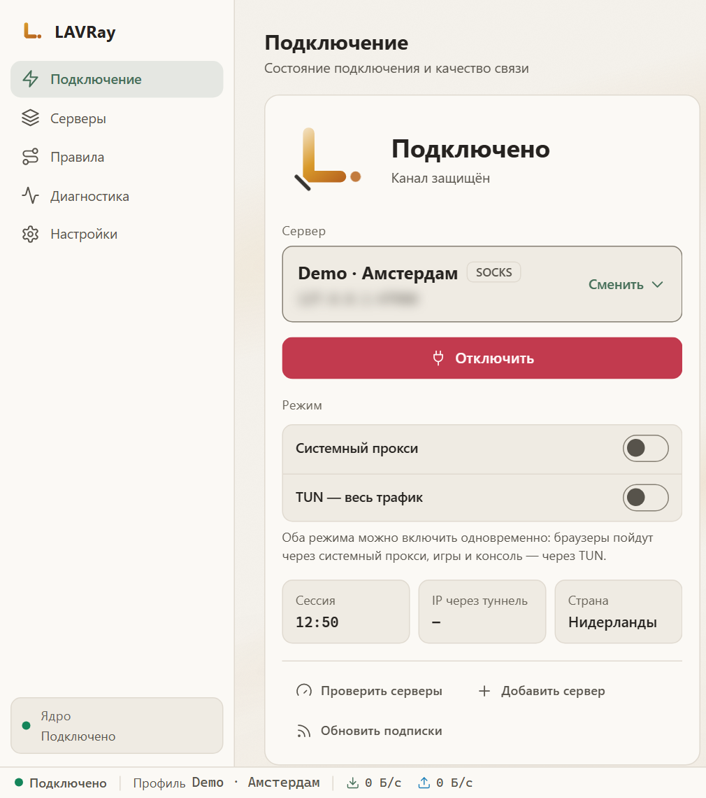
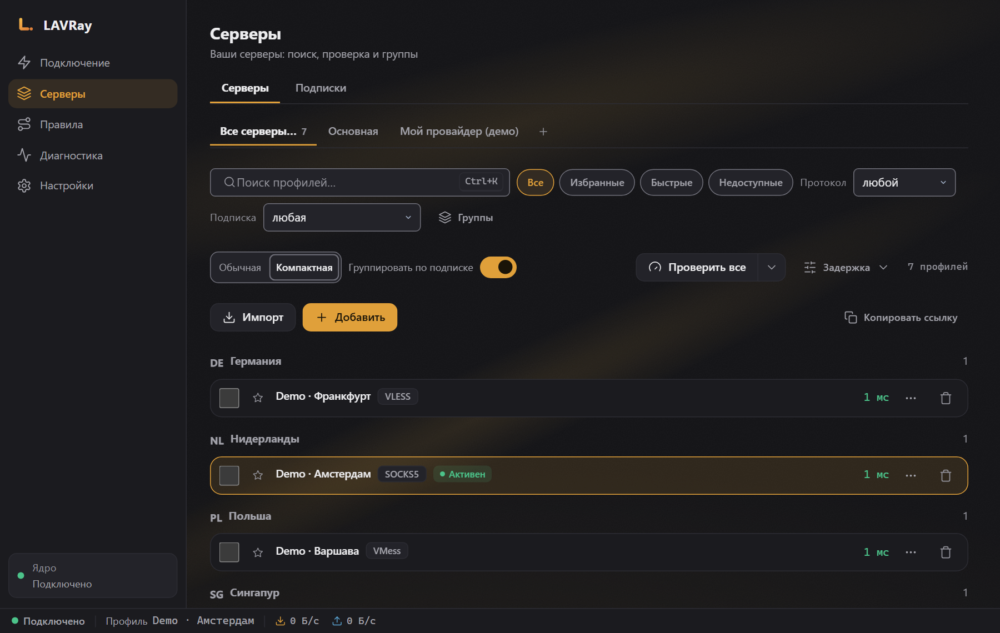
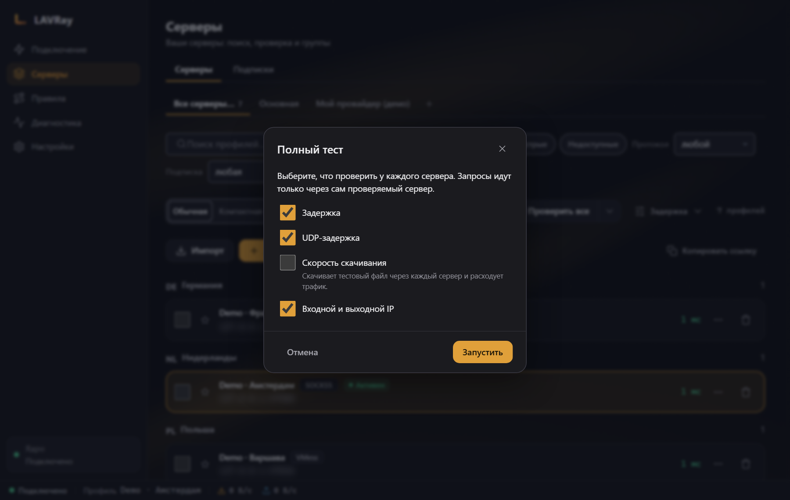
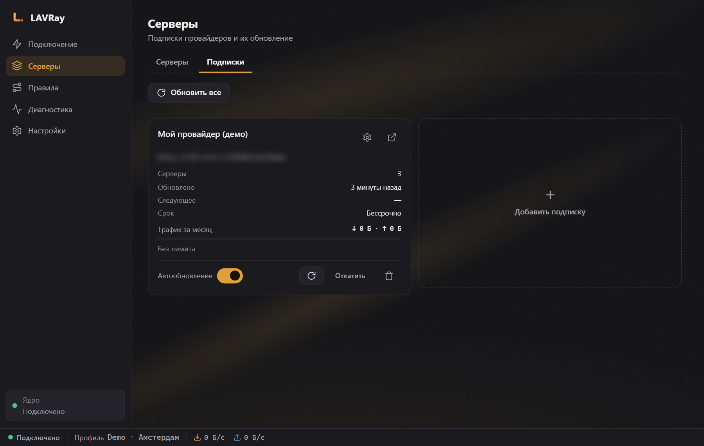
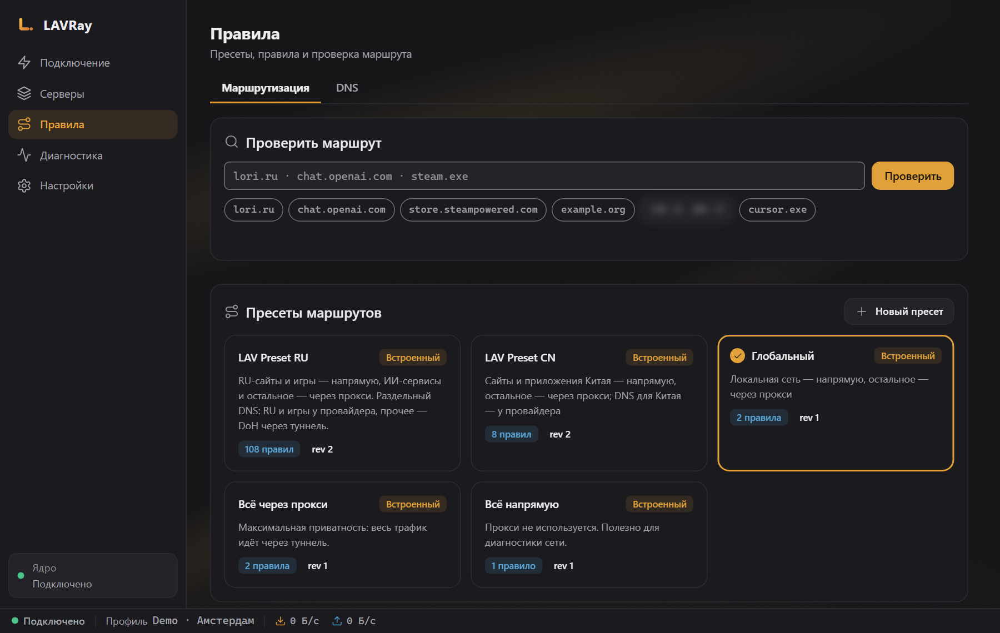
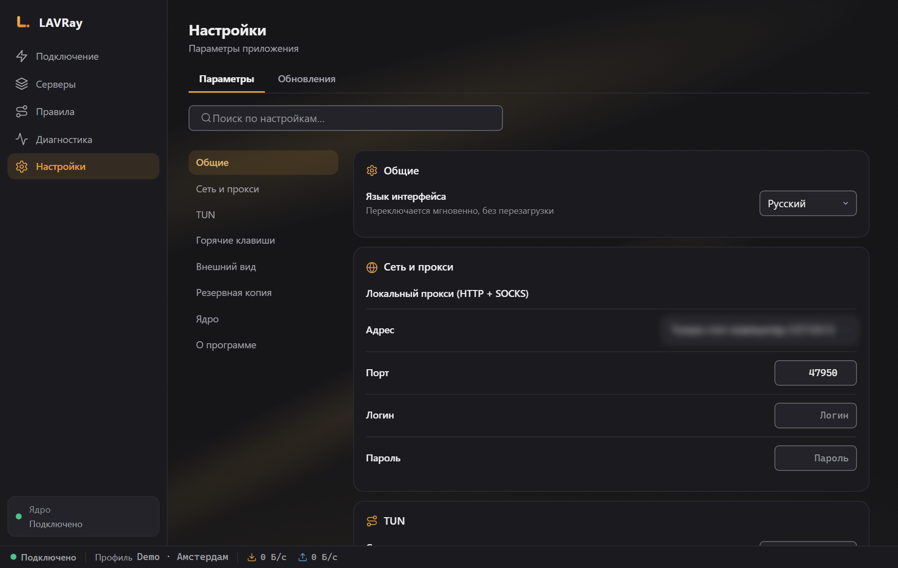
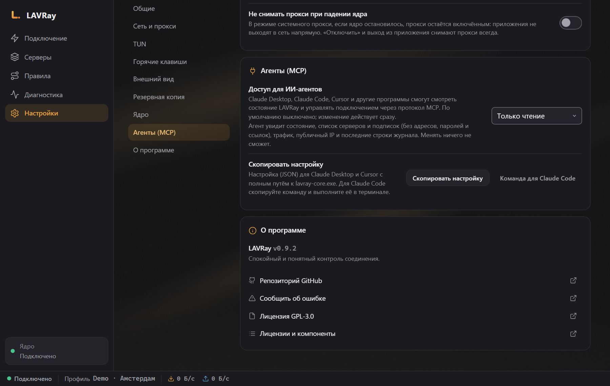

# LAVRay（Windows 版）

[Русский](README.md) · [English](README.en.md) · **中文** · [Español](README.es.md) · [Deutsch](README.de.md)

*本文是俄语版 README 的译文，版本发布说明（Release Notes）为俄语。*

**LAVRay** 是基于 [sing-box](https://github.com/SagerNet/sing-box) 内核的 Windows VPN 和代理客户端，是 NekoBox 的继承者。它连接到您的服务器和订阅，并且默认不会向订阅服务商发送任何设备信息。

<p align="center">
  
  
</p>

- **协议：** VLESS（包括 REALITY）、VMess、Trojan、Shadowsocks、Hysteria2、TUIC、SOCKS、HTTP。
- **两种模式，可以同时开启。** 系统代理用于浏览器和大多数程序。TUN 用于整台电脑的全部流量，包括游戏和命令行工具。
- **订阅**支持自动更新，可检测服务器（延迟、URL 测试、完整测试），并提供现成的路由规则集，包括“LAV Preset RU”（俄罗斯网站直连，其余经 VPN）。
- **智能体 (MCP)：** Claude、Cursor 等 AI 智能体可以查看状态，并且在您允许的情况下连接或切换服务器。参见[下方章节](#智能体-mcp)。

---

## 下载

最新版本请访问 [Releases](../../releases/latest) 页面：

| 文件 | 说明 |
|---|---|
| `LAVRay-<版本>-x64-setup.exe` | 安装程序（推荐） |
| `LAVRay-<版本>-portable-x64.zip` | 免安装：解压后运行 `LAVRay.exe` |
| `SHA256SUMS.txt` | 校验和 |

**安装程序**会将 LAVRay 安装到 `C:\Program Files\LAVRay`，并在安装时请求一次管理员权限。

**构建版本尚未签名。** 首次运行时，Windows SmartScreen 可能会显示“Windows 已保护你的电脑”——点击“更多信息” → “仍要运行”。您可以通过校验和验证文件的真实性：

```powershell
Get-FileHash .\LAVRay-0.9.2-x64-setup.exe -Algorithm SHA256
```

结果应与同一发布版本中 `SHA256SUMS.txt` 的对应行一致。

**系统要求：** Windows 10 或 11（x64）。需要 Microsoft Edge WebView2——Windows 11 和已更新的 Windows 10 中已预装。

---

## 快速开始

1. **添加订阅。** “服务器” → “订阅”标签页 → “添加”，粘贴服务商提供的链接，然后点击“刷新”。也可以通过“导入”按钮粘贴单独的服务器链接（`vless://`、`trojan://`、`ss://` …）。
2. **连接。** “连接” → 选择服务器（“更换”）→ “连接”。若已开启“系统代理”模式，浏览器即可通过 VPN 工作。连接后，LAVRay 会立即检查流量是否确实经过服务器；若没有，屏幕上会出现警告“已连接，但服务器没有任何流量通过”并附上原因。此时请选择其他服务器。
3. **需要全部流量（游戏、不支持代理的程序）？** 开启“TUN — 全部流量”。TUN 需要 Windows 管理员权限：LAVRay 会提示以管理员身份重新启动（只需确认一次 UAC 窗口），重启后会自动完成 TUN 连接。
4. **开机自启。** “设置” → “通用” → “开机自启”。如果 LAVRay 以管理员身份运行，开机自启将作为计划任务创建：登录 Windows 后，LAVRay 会以管理员权限直接在托盘中启动，TUN 无需弹出确认即可启动。没有管理员权限时则为普通的 Windows 开机自启。如果之前已在无管理员权限下开启了开机自启，只需以管理员身份运行一次已安装的 LAVRay（右键 → “以管理员身份运行”），它会自动将开机自启迁移为计划任务。便携版不会创建具有管理员权限的任务。
5. **自动连接。** “设置” → “通用” → “启动时自动连接”（默认关闭）。LAVRay 启动后，会以相同模式自动连接一次最近一次成功连接的服务器：最多尝试三次，总时长不超过 30 秒。如果未能连接，错误会显示在窗口中。“断开”仍然是断开：LAVRay 不会自行重新连接。TUN 需要带管理员权限的开机自启（见第 4 点）。

关闭窗口会将 LAVRay 最小化到托盘；可以在“设置” → “关闭时最小化到托盘”中关闭此功能。彻底退出请使用托盘图标菜单中的“退出”：内核会停止，系统代理会被解除。

**从 NekoBox 迁移？** 首次启动时（或在“设置”中）点击“从 NekoBox 迁移”：LAVRay 会自动找到 NekoBox 数据，显示将迁移的分组、服务器和路由数量，并一键完成迁移。重复迁移不会产生重复项。

---

## 使用方法

### 服务器



- 服务器按国家和订阅分组，支持搜索（`Ctrl+K`）、收藏，以及“低延迟” / “不可达”筛选。
- “全部测试”用于测量延迟。旁边的 ▾ 菜单中还有：
  - **URL 测试**：通过每台服务器打开真实网页，可以确认服务器是否真正可用，而不仅仅是端口是否有响应。也适用于 Hysteria2/TUIC。
  - **完整测试**：延迟、UDP、下载速度和出口 IP；通过勾选选择要测量的项目（速度测试会通过每台服务器下载文件，因此默认关闭）。



测试期间，当前连接不会中断。

服务器行菜单中包括：“显示二维码”（可用手机扫描）、“移到分组…”、“复制”、“重置流量”、“将域名解析为 IP”和“导出配置…”——导出的文件包含密钥，LAVRay 会就此发出警告。“清理…”会删除“不可用”（未通过检测的）或“重复项”——会先显示列表，确认后再删除；当前使用的服务器和链节点不会被删除。

“导入”支持链接、文件和二维码：可以来自图片、剪贴板或屏幕截图。XHTTP 链接可以导入，但会标记为“内核不支持”——目前无法通过此类服务器连接。

**服务器的自定义 JSON。** 服务器编辑器中有“自定义出站 JSON”（补充该服务器的出站配置）和“自定义配置 JSON”（补充整个配置）两个字段。保存后，LAVRay 会显示它们对最终配置的具体修改（此窗口中密码和密钥会被隐藏），只有在您勾选“我了解这会更改配置”并点击“应用”后才会生效。任何 JSON 修改都会撤销确认：此类服务器在列表中会标记“自定义：未确认”，点击即可打开同一窗口。

### 连接

“连接”界面会在您连接期间显示每个连接：地址、所经过的出站（含链式节点）、路由规则、已发送和已接收的数据量以及持续时间。“全部 / 代理 / 直连 / 拦截”标签和搜索用于筛选行，“暂停”可冻结列表。行菜单中有“复制地址”、“关闭连接”以及“创建规则：直连”/“创建规则：走代理”。关闭的连接会保留在历史记录中（最多 1000 条），直到关闭该界面；断开连接后历史记录会被清空。连接地址不会提供给智能体 (MCP)。

状态栏中的速度和“连接”界面的图表显示实际流量，旁边是“会话流量”。流量数据也会按每台服务器累计统计。

### 订阅



订阅可按计划自动更新，也可手动更新（“全部更新”会显示汇总结果）。更新采用事务方式：如果服务商返回错误或空列表，旧服务器将保留；更新失败的可以“回滚”。

### 路由规则



内置预设：“全局”、“全部走代理”、“全部直连”、**LAV Preset RU** 和 LAV Preset CN。在屏幕底部可以检查某个地址会走哪条路径。

自定义预设：“新建预设”、“复制”、“重命名”、“导出预设” / “导入预设”（包括 NekoRay 路由）、六个规则列表以及进程规则。内置预设不会被修改：编辑会创建副本，而“重置为原始预设”可将副本恢复为内置预设的内容。

### 诊断与日志

泄露检查（隧道和直连 IP、DNS、IPv6）直接位于“连接”界面。在“诊断”中可进行自检以及检查指定地址的路由；在“日志”标签页中，“复制日志”按钮会复制已隐藏密码、UUID 和订阅地址的日志，可以放心附在错误报告中。

### 设置



语言（Русский、English、中文、Español、Deutsch）、主题、本地代理端口、开机自启、启动时自动连接、“关闭时最小化到托盘”、最小化启动、“通知”、全局快捷键“连接 / 断开”、订阅更新、连接后检查连通性、智能体 (MCP)。

**“内核崩溃时保留代理”。** 开启后，在“系统代理”模式下内核异常停止时代理会保留，程序不会直接连入互联网；托盘会显示错误，界面上会出现“解除代理”按钮。断开连接和退出时始终会解除代理。

**“备份”**——“加密备份”会使用密码加密所有数据（包括订阅链接），并可“从备份恢复…”。没有密码将无法打开备份。

**与 NekoBox 或其他 VPN 客户端共存。** 如果本地代理端口（默认 2080）已被其他程序占用，LAVRay 将无法连接，并会直接提示端口被占用：请在“设置 → 网络与代理”中更改端口，或关闭其他程序。LAVRay 的 TUN 适配器地址与 NekoBox 不冲突。

---

## 隐私：订阅中看不到设备信息

许多服务商会根据客户端发送的标识符限制设备数量（HWID 以及 `x-hwid`、`x-device-os`、`x-device-model` 头）。**LAVRay 默认不发送这些头**，NekoBox 同样如此——订阅请求中只包含 User-Agent `LAVRay/<版本>`，不包含计算机信息。

如果服务商要求 HWID，可以在订阅设置中开启“发送设备标识（HWID）”。此时发送的是为本次安装随机生成的标识符，而不是序列号或硬件信息。

---

## 智能体 (MCP)

LAVRay 可通过 [MCP](https://modelcontextprotocol.io) 协议与 AI 智能体协作：您可以让 Claude 或 Cursor 执行“连接到最快的服务器”“检查服务器”“更新订阅”“我现在的 IP 是多少”等操作。



**如何启用**

1. LAVRay → “设置” → “智能体 (MCP)” → 选择模式：
   - **只读**：连接状态、服务器和订阅列表、流量、外部 IP、日志；
   - **读取和控制**：在上述基础上，还可以连接、断开、更换服务器、检测服务器、更新订阅。
2. 点击“复制配置”（用于 Claude Desktop 和 Cursor）或“Claude Code 命令”（程序路径会自动填入），然后粘贴：
   - **Claude Desktop：** Settings → Developer → Edit Config，编辑 `mcpServers` 部分，然后重启 Claude；
   - **Cursor：** Settings → MCP；
   - **Claude Code：** 在终端中执行复制的命令。

已安装版本的配置如下所示：

```json
{
  "mcpServers": {
    "lavray": {
      "command": "C:\\Program Files\\LAVRay\\binaries\\lavray-core.exe",
      "args": ["mcp"]
    }
  }
}
```

```bash
claude mcp add lavray -- "C:\Program Files\LAVRay\binaries\lavray-core.exe" mcp
```

只有在 LAVRay 打开时智能体才能工作。通过智能体连接的行为与应用中的按钮一致：在系统代理模式下，Windows 代理会被设置和解除。

**安全。** 默认关闭访问。智能体会获得一个独立密钥，只能执行有限的允许操作，权限检查由内核本身完成。智能体**无法看到**服务器地址、密码、UUID、订阅链接和访问过的网站（在日志中它们会被替换为 `[addr]`）。在任何模式下，智能体都无法导入、删除、更改设置或规则——因此，即使智能体读取了恶意网页，也无法让您被换成他人的订阅。详情请见主仓库中的 [`docs/MCP.md`](https://github.com/anatolijlaptev1991-ctrl/lavray/blob/main/docs/MCP.md)。

---

## 数据与卸载

| 内容 | 位置 |
|---|---|
| 服务器、订阅、设置 | `%APPDATA%\LAVRay` |
| 程序 | `C:\Program Files\LAVRay` |

卸载请通过 Windows“设置” → “应用”进行。无需提前关闭 LAVRay：卸载程序会自动关闭它并解除系统代理，程序文件夹会被整体删除（自 0.9.1 起）。开机自启会随程序一起移除。`%APPDATA%\LAVRay` 文件夹会保留，以便重新安装时不丢失服务器；如不需要，请手动删除。

---

## 尚不支持的功能

- **自动更新尚未配置。** “更新”界面已存在，但本版本中没有签名密钥，因此它会显示“更新未配置”。新版本需从 Releases 页面手动下载；安装程序会覆盖安装，设置和开机自启会保留。
- **XHTTP 传输**——链接可以导入，但内核目前不支持。
- **使用 Windows 证书对构建进行签名**（见上文 SmartScreen）。

---

## 报告问题

[创建 issue](../../issues/new/choose)：请说明您做了什么、预期结果是什么、实际结果是什么、LAVRay 版本，以及日志（“诊断” → “日志” → “复制日志”）。

## 源代码与许可证

代码（Go 内核、Rust/Tauri 外壳、React 界面）位于主仓库 [lavray](https://github.com/anatolijlaptev1991-ctrl/lavray) 中，从源码构建的方法也在那里（`shell/build.ps1`）。本仓库是 Windows 版本的发布页面。

许可证：[GPL-3.0-only](LICENSE)。LAVRay 基于 nekoray/NekoBox（GPL-3.0）和 sing-box（GPL-3.0 或更新版本）开发。
